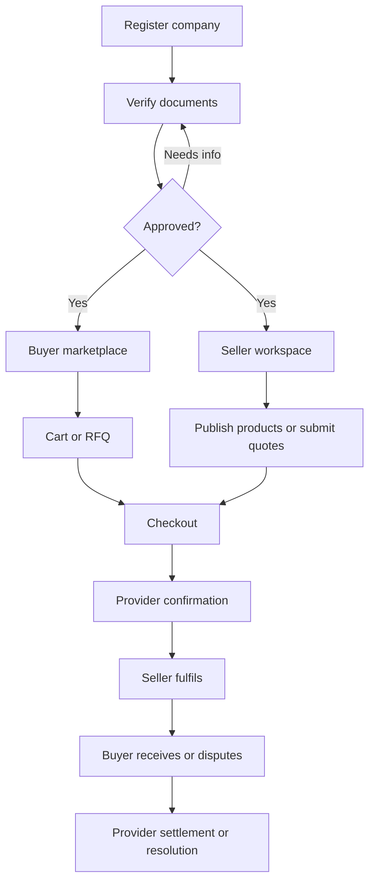

# Product requirements
## Goal
A verified UAE business can find wholesale suppliers, compare terms, purchase ready stock or request a manufacturing quote, pay through the platform and track fulfilment. Sellers manage a digital storefront, inventory, quotations and orders. Admin operates verification, trust, support and reconciliation.

## Scope
MVP: authentication, company verification, separate buyer/seller workspaces, catalog moderation, directory, search, RFQs and versioned quotes, wholesale cart, checkout, seller orders, seller-arranged shipment, messaging, notifications, disputes, finance records, admin. Custom manufacturing is quote-based in MVP with simple agreed delivery date; detailed milestones, deposits, bulk imports, team approval thresholds, analytics enhancements, paid membership, native apps and carrier integrations are phase 2. AI matching, trade finance referrals and international sourcing are future scope. No consumer accounts or platform-held wallet.

## Journeys

Business onboarding: verify email, create company, select buyer/seller or both, supply legal name, licence number/issuer/expiry, activity, emirate, address, contact, representative evidence, accept versioned terms; submit. Draft and rejected applicants can edit and resubmit; under review read-only except requested information. Approval enables trading for approved workspace. Suspension blocks new trading while existing orders and support remain accessible to authorized members.

Success measures: verified companies, monthly active buyers/sellers, RFQ response and conversion, paid GMV net of refunds (define separately from revenue), order delivery, dispute rate, repeat purchases, net platform fee revenue. Metrics use server events and explicitly labeled date ranges.
