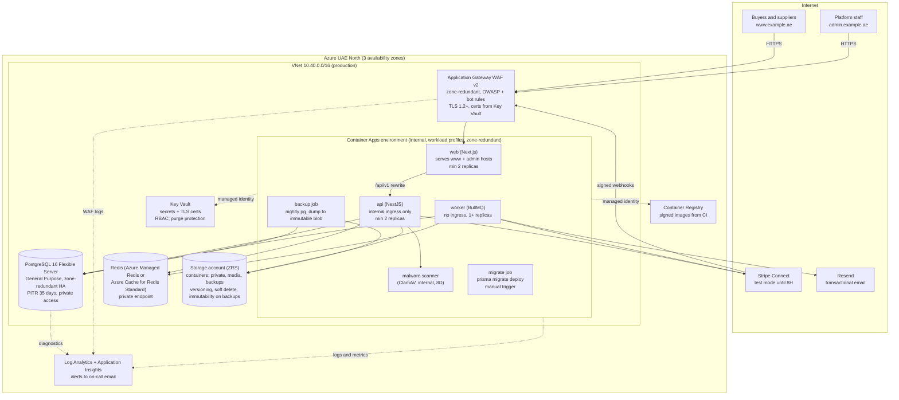

# Production architecture (Phase 8A proposal)

**Date:** 2026-11-28 (UTC).

**Status:** proposal for founder approval. **Nothing has been provisioned and no Azure account or subscription has been used.**

**Region:** Microsoft Azure UAE North (`uaenorth`, Dubai), as decided for D12.

## Principles
1. **Data stays in the UAE.** The database, files, backups, logs and secrets are all kept in UAE North. TLS is terminated in-region (Application Gateway), not at a global edge.
2. **Private by default.** PostgreSQL, Redis, Blob Storage and Key Vault have no public endpoint. They are reached only from the application subnet through private endpoints or VNet injection.
3. **The provider-independent application is unchanged.** The application stays three containers (web, api, worker) plus PostgreSQL, Redis and object storage, exactly as in local Docker. Azure-specific parts are limited to two things:
   - a Blob storage adapter (C-21);
   - environment values supplied as Key Vault references.
   Moving to another cloud means re-pointing those. Nothing is rewritten.
4. **Staging and production are separate.** Each has its own resource group, VNet, database, Redis, storage account, Key Vault and Log Analytics workspace, ideally in separate subscriptions. Staging never holds production data or keys.
5. **Infrastructure as code only.** Everything is in Terraform under `infra/azure`. There are no portal changes, apart from the one-time bootstrap of the state storage.

## Diagram

The same layout is used for staging, scaled down (see `cost-estimate.md`). Staging differences:
- The Application Gateway is replaced by Container Apps ingress restricted to an IP allowlist. A temporary WAF is added only for the penetration test (8F).
- The database is Burstable with no HA.
- Redis is Basic.
- Storage is LRS.

## Components

| Layer | Service | Production configuration | Why |
|---|---|---|---|
| Edge and WAF | Application Gateway WAF v2 | Zone-redundant, autoscale 1–4 capacity units, OWASP CRS 3.2 / DRS managed rules in Prevention mode, bot manager rules, request size limits, HTTP→HTTPS redirect. Listeners for `www`, `admin` and `api` (webhooks only). Certificates come from Key Vault. | In-region TLS termination keeps traffic inside the UAE. Managed rule sets are included. **Alternative:** Azure Front Door (global edge, see `cost-estimate.md`). |
| Web | Container Apps: `web` | Next.js standalone build, 1 vCPU / 2 GiB, 2–6 replicas. Serves both the public and admin hosts (A03 separation is by host and cookie, as today). | Matches the current single web app with host-based admin. |
| API | Container Apps: `api` | NestJS, 1 vCPU / 2 GiB, 2–6 replicas. **Internal ingress only.** The browser reaches it through the web rewrite. PSP webhooks are routed by the gateway path rule to `api`. | Keeps cookies first-party (A03). The API is never exposed directly. |
| Worker | Container Apps: `worker` | 0.5 vCPU / 1 GiB. Minimum 1 replica, scaling on queue depth (KEDA Redis scaler). | BullMQ jobs: email, settlement, expiry, exports, retention reports. |
| Jobs | Container Apps jobs | `migrate` runs `prisma migrate deploy`, triggered manually from CI after approval. `backup` runs a nightly `pg_dump` to an immutable blob container. `restore-check` runs monthly in staging. | Additive migrations only. Approval gates are kept. |
| Malware scanning | ClamAV container (internal), or Microsoft Defender for Storage | Decided in 8D. ClamAV fits the current scan-before-use design (synchronous, in-region). Defender is cheaper but asynchronous. | Production refuses to start without a live scanner (T38). |
| Database | Azure Database for PostgreSQL flexible server 16 | General Purpose D2ds_v5 (2 vCore, 8 GiB), zone-redundant HA (standby in another zone), 128 GiB Premium SSD with autogrow, PITR retention 35 days, private access (delegated subnet), TLS required, Entra ID admin, `pgaudit` on DDL and role changes. | Ledger and orders need durability. HA gives automatic zonal failover. |
| Cache and queues | Azure Managed Redis (Balanced B1), or Azure Cache for Redis Standard C1 | Private endpoint, TLS only, no public network, `maxmemory-policy noeviction` (required by BullMQ). | Rate limiting and job queues. Microsoft has announced the retirement of Azure Cache for Redis in favour of Azure Managed Redis; check whether new caches can still be created before provisioning. |
| Files | Storage account StorageV2, ZRS | Containers: `private` (verification documents, attachments, proofs, exports), `media` (approved product images, served through the API), `backups` (immutability policy, 35 days). Public access disabled. Shared-key access disabled (managed identity only). Versioning and 30-day soft delete. Private endpoint. | Private bucket rule (docs/10-security). |
| Secrets | Key Vault Standard | RBAC mode, purge protection, soft delete 90 days, private endpoint. Container Apps read secrets through user-assigned managed identity with Key Vault references. | No secrets in git, env files or CI logs. |
| Images | Azure Container Registry | Images built and scanned in GitHub Actions, then pushed with OIDC federation (no stored credentials). Pulled by managed identity. Admin user disabled. Public endpoint with Entra ID authentication only (private endpoints would need the Premium tier, about USD 50 per month more). | Supply chain control. |
| Observability | Log Analytics workspace + workspace-based Application Insights + Azure Monitor alerts | Container console and system logs, PostgreSQL and Gateway diagnostics, 90-day retention (production). Alerts: 5xx rate, p95 latency, replica restarts, database CPU and storage, failed logins burst, webhook quarantine count, backup job failure, certificate expiry. | Operations and incident response. Redaction stays in the app (`LOG_REDACT_PATHS`). |
| Networking | VNet with subnets for gateway, Container Apps (`/23`), PostgreSQL (delegated) and private endpoints | Private DNS zones for blob, vault, redis and postgres. NSGs deny inbound except gateway→Container Apps. Outbound to Stripe and Resend only over HTTPS (optional NAT Gateway for a fixed egress IP if a provider requires an allowlist). | Private data plane. |

## Recovery objectives (RPO and RTO)

The proposed objectives are **RPO 24 hours / RTO 4 hours**.

**Recommendation:** for the financial database (orders, payments, ledger, refunds, payouts, audit), set **RPO ≤ 15 minutes** (expected ~5 minutes) and keep **RTO 4 hours**.

Reasons:
1. **Continuous PITR at no extra compute cost.** Azure PostgreSQL flexible server already takes continuous WAL backups and supports point-in-time restore to any second within the retention period. A 24-hour RPO would mean planning to lose up to a day of payments, refunds and payout approvals. Those would then have to be rebuilt by hand from provider records.
2. **Provider events give a second source.** After a restore, the reconciliation job compares the ledger against Stripe balance transactions for the gap window. Missing events are replayed through the existing idempotent webhook processing.
3. **Zonal failures are covered by HA.** Zone-redundant HA fails over automatically, typically in about two minutes.
4. **A regional disaster is the open risk.** The paired region UAE Central is **access-restricted** (no availability zones, used for in-country disaster recovery on request). Geo-redundant backup or a cross-region replica in UAE Central needs a Microsoft region access request. Using a region outside the UAE would conflict with data residency (A14) and needs legal approval.
   - **Until UAE Central access is granted:** the nightly `pg_dump` and blob versioning in ZRS storage give a same-region copy.
   - **Regional RTO** is then the time to rebuild from Terraform plus restore (estimated 4–8 hours, to be measured in the 8B drill).

| Data | RPO | RTO | Mechanism |
|---|---|---|---|
| PostgreSQL (all, including ledger) | ≤ 15 min (zonal / logical error), 24 h (regional, until UAE Central access) | 4 h | Zone-redundant HA + PITR 35 days + nightly logical dump (immutable 35 days, monthly kept 12 months) |
| Blob files | ~0 (ZRS), 30 days for deletion or overwrite | 4 h | ZRS + versioning + soft delete. Geo-redundancy needs UAE Central access. |
| Redis | Not a system of record | 1 h | Queues are rebuilt from the database outbox. Rate limit counters are disposable. |
| Secrets | Not applicable | 1 h | Key Vault soft delete + purge protection. Recreated from Terraform. |
| Infrastructure | Not applicable | 4 h | Terraform state in a separate, locked storage account |

**Drills:**
- The existing `pnpm db:restore-check` (T37) runs monthly against a PITR restore in staging.
- A full regional rebuild drill runs before the pilot (8B/8G), timed against the 4-hour RTO.

## Environments

| | Staging | Production |
|---|---|---|
| Subscription | Separate (recommended), or a separate resource group | Separate |
| Purpose | Sandbox integration testing: Stripe test mode, Resend sandbox or test domain, penetration test | Pilot, then launch (after 8H approval) |
| Data | Seeded fictional data only | Real data, after legal approval |
| Mode | `APP_ENV=staging` (C-20): sandbox adapters allowed, labelled; all production hardening on | `NODE_ENV=production`: refuses sandbox adapters (T38) |
| Access | IP allowlist + basic gateway auth; no public registration | Public after 8H approval |
| Cost control | Scale to zero outside test windows; database stop/start | Reserved capacity after 3 months of steady load |

## Deployment flow
1. A PR merged to `main` triggers CI:
   - lint, typecheck, tests, E2E;
   - image build;
   - container scan (Trivy) and SBOM;
   - push to ACR, tagged with the commit SHA.
2. Deploying to staging requires a manual GitHub environment approval:
   - Terraform plan, reviewed, then applied;
   - the `migrate` job runs;
   - the Container Apps revisions are updated;
   - smoke tests run.
3. Deploying to production requires founder or delegated approval in the GitHub `production` environment (only after 8H). It is the same image digest that passed staging. Rollback is done by moving traffic to the previous revision.

GitHub Actions authenticates to Azure by OIDC workload identity federation, with no client secrets stored. The production principal can only deploy; it cannot read Key Vault secret values.

## Open items before provisioning (see `azure-region-verification.md`)
- Confirm UAE North availability and quota in the new subscription for:
  - PostgreSQL flexible server (General Purpose, zone-redundant HA). A November 2026 community report shows `SkuNotAvailable` in UAE North that was not resolved by quota.
  - Container Apps workload profiles with zone redundancy.
  - Azure Managed Redis.
  - Application Gateway WAF v2.
- Request UAE Central access for geo-redundant backups if regional disaster recovery is required.
- Confirm the Azure billing currency and agreement (pay-as-you-go, Microsoft Customer Agreement through a local partner, or CSP) and the VAT treatment.
