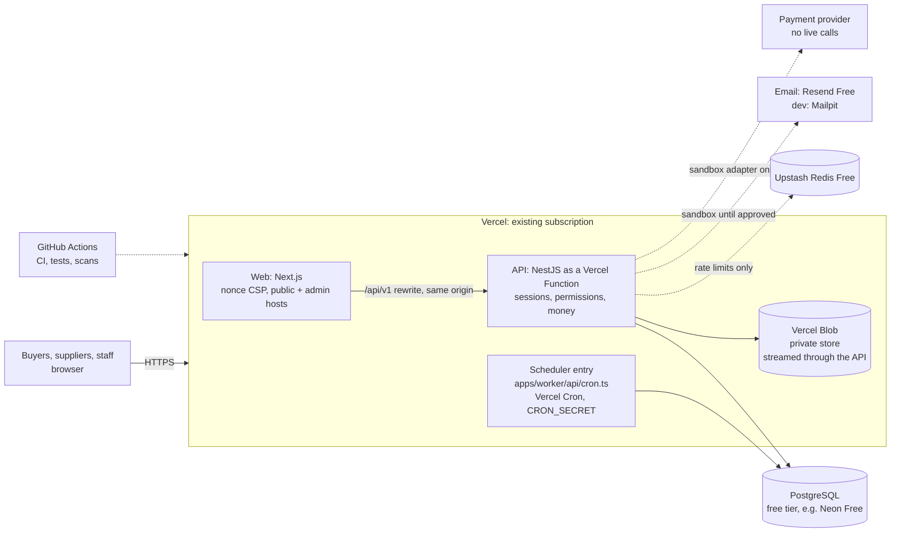

# Vercel-first architecture at zero added cost

**Date:** 2026-11-28 (UTC). **Status:** proposal for founder review. **Nothing has been provisioned, connected or subscribed.**

**Governing decision:** the founder's message of 2026-11-28 09:28 UTC.
- The only paid subscriptions authorised are Vercel, ChatGPT and Claude.
- Target: AED 0 of additional monthly cost in development and staging.
- No new subscriptions, auto-renewing trials, plan upgrades, payment methods on third-party services, usage-based billing, domain purchases or live payments without explicit approval.
- The Azure proposal (8A) is rejected. It is archived in [archive/azure](archive/azure/README.md) and [`infra/archive/azure`](../../infra/archive/azure/README.md).

**How facts were checked:**
- Vercel behaviour was checked against Vercel's published documentation on 2026-11-28, through the Vercel documentation search. Pages used:
  - `vercel.com/docs/schedules/cron-jobs`
  - `vercel.com/docs/cli/schedules`
  - `vercel.com/docs/vercel-blob/private-storage`
  - `vercel.com/docs/functions/configuring-functions/region`
  - `vercel.com/docs/spend-management`
- Numbers marked **confirm** were not shown in those pages. They must be read from the provider's pricing page, or from the founder's own account, on the day a service is chosen. Free tiers change, and an assumed limit is how an unexpected charge happens.
- The Vercel connector in this session could not see the founder's team, so the founder's plan, included usage and existing budgets have not been read. They are listed under [Questions for the founder](#questions-for-the-founder).

## 1. Architecture

| Concern | Design | What already exists in code |
|---|---|---|
| Web | Next.js on Vercel. Public and admin hosts are separate (decision 3), with host routing in middleware. | Done. The nonce-based CSP is in PR #18. |
| API | NestJS deployed as a Vercel Function behind the web origin's `/api/v1` rewrite. Cookies stay first-party. Stateless between requests: sessions, idempotency keys and outbox all live in PostgreSQL. | The API is already stateless. A Vercel entry file and build settings are still needed (8B). |
| Background work | The PostgreSQL scheduler (P8-12). The same tasks run from the long-running worker (local) or from one scheduled function. Leases use the database clock, a killed run is retried when its lease expires, and every handler is idempotent. **Financial operations are never lost when a function stops.** | Done (PR #15). |
| Database | One managed PostgreSQL 16 database per environment on a free tier. Prisma migrations only. A pooled connection is used for functions and a direct connection for migrations. | The schema and migrations are done. Only a connection string is needed. |
| Private documents | Vercel Blob **private** store. Files are never public. The API checks membership and permission, then streams the file (Vercel documents this pattern for private storage). No public or presigned URL is ever given to a browser. | The storage interface exists (S3 driver). A Vercel Blob adapter is still needed (8B, C-21). |
| Public media (approved product images) | The same private store, served through the API's media route with caching headers. No public bucket is needed. | The media route exists. |
| Rate limiting | Upstash Redis free tier, used only for rate limits, as the founder decided. If it is unavailable, the API falls back to PostgreSQL counters, with no in-memory or allow-all fallback. | Rate limits use Redis today. The PostgreSQL fallback is still needed (8B). |
| Email | Resend free tier for staging only after approval. Mailpit in development. Production refuses to start without a live adapter. | Sandbox adapter, labelled. |
| Malware scanning | ClamAV (open source) is not available as a Vercel Function. Options are in section 5. Production refuses to start without a scanner. | Sandbox scanner, labelled. |
| Payments | Sandbox adapter only. No live provider calls. | Done (sandbox). |
| CI | GitHub Actions on this repository. | Done. The Azure Terraform job is removed in this change. |

## 1a. Backend compatibility assessment

| Component | Runs on Vercel as is? | Adaptation needed | Status |
|---|---|---|---|
| Next.js web (public, buyer, supplier and admin areas) | Yes | None. Admin stays on a separate host (a second Vercel project or domain alias). | Ready |
| NestJS API (`apps/api`) | Yes, as a Node.js Vercel Function | A small serverless entry that boots the Nest app once per instance and reuses it; build settings. The API keeps no state in memory between requests. | 8B, small |
| Prisma and PostgreSQL | Yes | A pooled connection string for functions and a direct one for migrations. Migrations, constraints, audit triggers, journals and row locks are standard PostgreSQL and need no change. | 8B, config only |
| BullMQ worker | **No** (needs a process that never stops) | Replaced by the PostgreSQL scheduler with leases (PR #15). BullMQ and ioredis are already removed from the worker. | Done |
| Background tasks (stock reservation expiry, quote expiry, licence expiry, email outbox, auto-completion, dispute window, payout eligibility, weekly payouts, ticket auto-close, notifications, payment event processing and reconciliation cases) | Yes, through one scheduled function | Each task is a row in `background_tasks`, claimed under a lease, retried with backoff, idempotent and shown on the admin overview. Email uses a transactional outbox: it retries with exponential backoff and moves to a dead state after the maximum attempts, so nothing is silently dropped. | Done |
| Redis in the API (rate limits, TOTP replay guard, readiness check) | Yes, with Upstash (TLS Redis protocol) | Point `REDIS_URL` at Upstash. Redis never holds financial data. A PostgreSQL fallback for rate limits is proposed so a free-tier cap cannot turn into allow-all. | 8B |
| File storage (S3 interface) | Partly | Vercel Blob is not S3-compatible, so a Vercel Blob adapter is needed behind the existing storage interface. Until it exists, confidential uploads stay in sandbox mode, as the founder required. | 8B (C-21) |
| Malware scanner | **No** inside a function | See section 5. | Decision needed |
| Email adapter | Sandbox now | A Resend adapter behind the existing interface, after domain and data-processing approval. | 8D |

Nothing from Phases 0 to 7 is removed to fit the platform. Where a component cannot run on Vercel, it is replaced by an equivalent with the same guarantees (the scheduler), or kept in sandbox mode until an approved option exists.

## 2. Services in the founder's four categories

| Service | Category | Use | Commercial use allowed on the free option? | Trial that converts? | Card needed? | What happens at the limit | Region | Verdict |
|---|---|---|---|---|---|---|---|---|
| **Vercel** (hosting, Functions, CDN) | Included in Vercel | Web, API, scheduler entry | Yes on the paid plan the founder has. **Confirm the plan:** Hobby is for non-commercial use only. | No | Already on file | Usage above the plan's included amount is billed on paid plans. Spend Management can **pause production deployments** when a budget is reached (`vercel billing budgets set --amount … --pause`). | Function region is configurable. **Confirm** whether a UAE region (Dubai) is available to the account. Otherwise the nearest region. | Use |
| **Vercel Cron** (or Vercel Schedules) | Included in Vercel | Triggers the scheduler | Yes | No | No | **Confirm frequency per plan.** Docs say Cron Jobs are a legacy feature being migrated to Schedules, and that on Hobby Schedules run at most once every 15 minutes. | Same as functions | Use. See section 4. |
| **Vercel Blob** (private store) | Included in Vercel, with a limited allowance | Verification documents, product media | Yes | No | Already on file | **Confirm** the included storage and transfer on the plan. Above that it is usage-billed, so it is covered by the Spend Management budget. | Store region is chosen at creation (default `iad1`). **Confirm** whether a Middle East region is offered. | Use, with a budget |
| **Neon Free** (PostgreSQL) | Limited free tier | Staging database | **Confirm** in the current terms | No (free plan, not a trial) | **Confirm.** Last known: no card for Free. | **Confirm.** Last known: compute auto-suspends, and storage per project and restore history are small. The free plan does not bill, it stops or throttles. | No Middle East region is known. **Confirm**, since the nearest is likely Europe or Asia. | Staging only. Production needs a decision (section 6). |
| Supabase Free (PostgreSQL alternative) | Limited free tier | Alternative staging database | **Confirm** | No | **Confirm** | Last known: inactive free projects are paused. | No Middle East region is known. | Fallback only |
| **Upstash Redis Free** | Limited free tier | Rate limits only | **Confirm** | No | **Confirm.** Last known: no card for Free. | **Confirm.** Last known: requests are refused above the daily or monthly command cap, with no billing on Free. The API falls back to PostgreSQL counters. | **Confirm** regions | Use (founder decision) |
| **Resend Free** | Limited free tier | Staging email after approval | **Confirm** | No | **Confirm** | **Confirm.** Last known: a small daily and monthly cap, with sends refused above it. It needs a verified sending domain, and **no domain will be bought**, so staging email waits for an existing domain. | n/a | Use for staging once a domain exists |
| **GitHub Actions** | Limited free tier (existing GitHub) | CI | Yes | No | Existing account | **Confirm** the minutes included for this private repository. Above that, Actions stops unless a spending limit above $0 is set. **Keep the spending limit at $0.** | n/a | Use |
| **ClamAV** | Completely free (open source) | Malware scanning | Yes (GPL) | No | No | n/a. It needs somewhere to run (section 5). | Wherever it runs | Needs a host |
| Vercel Marketplace integrations (Neon, Upstash, Supabase and others through Vercel) | **Not assumed included.** As instructed, each one is a separate provider with its own terms and possibly its own billing through Vercel. | | | | | | | Do not install through the Marketplace without approval. Sign up directly on the free plan instead, so no billing is attached to the Vercel account. |
| Payment providers (Stripe Connect, Mamo) | Transaction-based | Live payments (later) | n/a | n/a | n/a | Fees per transaction, only once live. **Not connected; test mode only after approval.** | n/a | Later, with approval |

**Summary:**
- Development: **AED 0.** It runs locally with Docker.
- Staging on free tiers: **AED 0**, provided that:
  - (a) the founder's Vercel plan includes the usage;
  - (b) a Spend Management budget with pause is set;
  - (c) the free tiers are joined directly, not through the Marketplace;
  - (d) GitHub's spending limit stays at $0.

## 3. Usage-charge risks and spend protection

These are the things that can cost money without anyone buying anything.

| Risk | Protection |
|---|---|
| Vercel Function, bandwidth or Blob usage above what the plan includes | Spend Management budget at a small amount with **pause production** and a webhook alert (Owner or Billing role). Staging protected by Vercel Authentication so crawlers cannot drive usage. Rate limits on every public route. |
| A cron that runs too often and keeps functions busy | One scheduler entry that does all due work and exits early when nothing is due (`runDueTasks` with a deadline). Run frequency set in one place. |
| Marketplace integrations that bill through Vercel | Not used. Free plans joined directly. |
| GitHub Actions minutes | Spending limit $0. CI uses one job and caches dependencies. The Terraform job is removed. |
| A free tier that silently converts to paid | Only plans that are free with no card are used. Anything that asks for a card is a stop-and-ask. |
| Domain purchase | None. Staging uses the `*.vercel.app` address. Email waits for an existing domain. |

**Which controls stop usage, and which only notify:**

| Control | Stops usage? | Notes |
|---|---|---|
| Vercel Spend Management budget **with pause** | **Yes**: production deployments are paused when the budget is reached | Owner or Billing role. The site goes offline until it is resumed, which is acceptable for staging. |
| Vercel Spend Management budget without pause, and its webhook | No, notify only | Use it at 50% and 80% for warning. |
| Free plans that need no card (Neon, Upstash, Resend free) | **Yes**: the service refuses or throttles at its cap; it cannot bill | Confirm each one's behaviour on the day it is chosen. |
| GitHub Actions spending limit of $0 | **Yes**: jobs stop when the included minutes run out | |
| App rate limits (per IP and per account) | **Yes**: requests above the limit get HTTP 429 | Already built. |
| Upload size limit (`UPLOAD_MAX_BYTES`) and file-type checks | **Yes**: larger or disallowed files are refused | Already built. |
| Vercel Authentication on staging | **Yes**: blocks anonymous and automated traffic | Also keeps staging private, as required. |
| Database and email usage dashboards | No, notify only | Checked weekly. The admin overview shows background-task health. |

## 4. Background work on Vercel

- The scheduler is in code and tested (PR #15, P8-12).
- How often it runs depends on the plan:
  - If the founder's plan allows a schedule every minute, the configured `* * * * *` gives payment events and outbox delivery a delay of up to a minute.
  - If only every 15 minutes is allowed (Hobby Schedules), staging still works. Payment webhooks are written to the database first and processed on the next run, so a delay of up to 15 minutes is acceptable for staging but **not for production checkout confirmations**.
- In both cases a user action never waits for the cron. Webhook intake and checkout are synchronous API calls. Only follow-up work (emails, settlement sweeps, expiry) waits.
- There is a free fallback for faster processing without a plan change: the API also runs due tasks opportunistically after webhook intake. This is a small, idempotent change because tasks use leases. It is proposed, not done.
- A GitHub Actions schedule is **not** recommended as the trigger. Every run is billed as at least one minute, so it would use up the free minutes.

## 5. Database, storage and scanning plan

- **Database (staging):** Neon Free, joined directly.
  - Migrations run with `prisma migrate deploy` from CI on merge to `main`, using the direct connection.
  - Functions use the pooled connection.
  - Seeded fictional data only.
- **Database (production):** not decided. A free tier is not suitable for production financial data: compute suspends, restore history is small and there is no support.
  - **RPO 15 minutes is approved but must be proven by a restore drill.** Until a drill on the production database meets it, this is a **launch blocker** (see the readiness checklist).
  - Options for the founder, each with a cost: Neon paid plan (PITR); Supabase paid plan; or a UAE-hosted managed PostgreSQL for residency. **Each needs approval.**
- **Private documents:** a Vercel Blob private store, streamed through the API after a permission check.
  - Nothing public, and no presigned links in the browser.
  - Object names are random. Company and file IDs are checked on every read, so a file from another company returns 404.
- **Malware scanning:** ClamAV cannot run inside a Vercel Function (it needs a resident daemon and about 1 GB of signatures). Options:
  1. Run ClamAV on an existing machine the founder already pays for (AED 0 added), reached over HTTPS with a shared secret.
  2. Keep uploads **quarantined** (not downloadable by anyone except the uploader and compliance) until a scanner is approved. This is the current production refusal: production will not start without a scanner.
  3. Use a paid scanning API (needs approval).

  Recommended: option 2 for staging, and option 1 or 3 decided before the pilot.

## 6. Data residency

- No Middle East region is confirmed for the database or Blob providers above.
- **Confirm** whether Vercel offers a Dubai function region to the account. If not, the nearest available region is used.
- Storing UAE business verification documents and financial records outside the UAE may need legal review under the PDPL and any sector rules. This is listed as a risk (R-27) and a question.
- Staging with fictional data has no residency concern.

## 7. Limits of this design (documented, not hidden)

| Limit | Effect | Proposed alternative |
|---|---|---|
| Free database tiers suspend and have short restore history | Not suitable for production money. RPO 15 min cannot be proven. | Paid database plan (approval) before the pilot |
| Cron frequency may be 15 minutes on lower plans | Follow-up work delayed | Opportunistic task runs after webhooks (free). Confirm the plan. |
| No managed malware scanner at AED 0 | Uploads stay quarantined | ClamAV on an existing machine, or a paid API (approval) |
| No sending domain without a purchase | No real staging email | Use an existing domain the founder owns. Mailpit meanwhile. |
| No UAE region confirmed | Residency question | Legal review. A UAE-hosted database for production (approval). |
| Vercel Function duration limits | Long exports or reports could time out | Exports already stream. Long jobs run as scheduler tasks in short batches. |

## 8. Staging deployment instructions (to run only after approval)

Nothing below has been run. Each step that creates a resource needs the founder's go-ahead.

**Code to finish first (8B):**
1. Staging profile `APP_ENV=staging` (C-20): production-like settings with labelled sandbox adapters allowed.
2. Vercel entry for the API (NestJS as a function).
3. Vercel Blob storage adapter (`STORAGE_DRIVER=vercel-blob`), with tests.
4. PostgreSQL fallback for rate limits.
5. Opportunistic scheduler run after webhook intake.

**Then, in order:**
1. **Founder:** set a Spend Management budget with pause on the Vercel account (Settings, Billing, Spend Management).
2. **Founder:** create free accounts directly (not through the Vercel Marketplace): Neon Free (project `marketplace-staging`) and Upstash Redis Free. Check that neither asks for a card.
3. Create three Vercel projects from this repository: `web` (root `apps/web`), `api` (root `apps/api`) and `worker` (root `apps/worker`, which only holds the cron entry). Turn on Vercel Authentication for all three.
4. Set environment variables in each project, from the inventory in `environment-variables.md`:
   - `NODE_ENV=production`, plus the staging profile once C-20 (`APP_ENV=staging`) is built. Until then, production's refusal to start without live integrations blocks a staging deploy, which is exactly why C-20 is listed in 8B;
   - `PAYMENT_MODE=mock` (the labelled sandbox provider), `EMAIL_PROVIDER=disabled` or `smtp-dev`, `FILE_SCANNER=sandbox-eicar` with fictional files only, `TRADING_ENABLED` and `FEATURE_REAL_PAYMENTS` off;
   - `DATABASE_URL` (pooled), plus a direct URL for migrations (to be added with the Vercel entry);
   - `REDIS_URL`;
   - session and webhook secrets (generated, never committed);
   - `CRON_SECRET` (at least 32 characters);
   - `TAX_TREATMENT=provisional_standard`.

   No production credentials, and no live payment or email keys.
5. Run `prisma migrate deploy` against the staging database (direct URL) from CI, then seed fictional companies only.
6. Deploy. Check `/api/v1/health/ready`, sign in with a seeded account, and confirm that the admin overview shows background tasks running.
7. Run the restore drill (`pnpm db:restore-check`) against staging to rehearse the procedure. **This does not prove the production RPO.**

## Questions for the founder
1. Which Vercel plan is the subscription? Hobby does not allow commercial use, and its schedule frequency is lower.
2. Does the account offer a Dubai (UAE) function region?
3. May we set a Vercel Spend Management budget with pause? At what amount (for example USD 0 on-demand)?
4. May we join Neon Free, Upstash Free and Resend Free directly (no card) for staging?
5. Is there an existing domain we may use for staging email, or should staging use Mailpit only?
6. For production: which paid database option (with PITR for the 15-minute RPO) do you want priced for approval, and is a UAE-hosted database required?
7. Malware scanning: may ClamAV run on a machine you already pay for, or should uploads stay quarantined until a paid scanner is approved?
