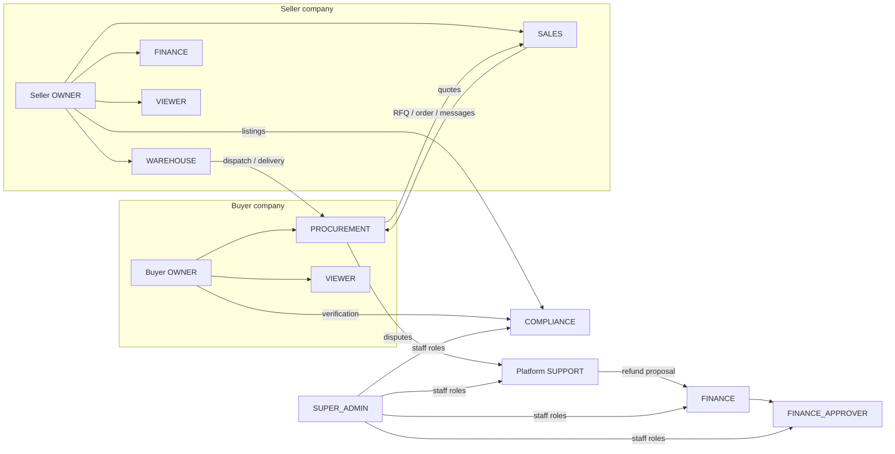

# 2. User types and permissions

Permissions are enforced on the server for every operation (company membership + resource-level checks). The web app only hides or disables controls to match; it is never the source of truth. Source: `packages/contracts/src/permissions.ts`, `docs/10-security.md`, decision register D04 and A12.

## 2.1 Account types

| Account type | How it is created | Where it signs in | Session |
|---|---|---|---|
| Guest | — | — | none |
| Company user | Self-registration (AUTH-01) or invitation (AUTH-08); email verification mandatory (D07) | Main origin `/{locale}/login` | Server session in PostgreSQL, cookie `__Host-…` SameSite Lax (D01) |
| Platform admin (staff) | Provisioned by script; **no public registration** (D03) | Separate admin origin (`admin.` host) `/{locale}/admin/login` + mandatory TOTP (D02) | Isolated cookie `asid`, SameSite Strict |

A company user can belong to several companies and workspaces (one membership per workspace). A **company** can have a **buyer workspace**, a **seller workspace** or both; roles are per workspace and never mixed.

## 2.2 Viewer tiers on the public marketplace (A12)

| Tier | Who | Can see | Can do |
|---|---|---|---|
| Guest | Not signed in | Catalogue, storefronts, categories, **no prices** | Search, filter (non-price), browse |
| Verified user | Signed in with verified email, any company state | Prices, price filters and sorts, price calculator | Save products/suppliers, compare, recently viewed, preferences |
| Trading buyer | OWNER or PROCUREMENT of an **ACTIVE** (approved) buyer workspace | Everything above | Add to cart, checkout, pay, RFQs, messaging |

Trading capabilities (`marketplace.browse`, `buyer.purchase`, `buyer.orders.act`, `seller.catalog.edit`, `seller.inventory.ship`, `messaging`) are removed automatically while a workspace is not ACTIVE (pending verification, restricted by licence expiry or compliance suspension). Read-only access to orders, catalogue and finance remains.

## 2.3 Company roles

### Buyer OWNER
- **Who:** founder, director or authorised signatory of a buying company. First user of a company is its owner.
- **Objectives:** get the company verified, purchase and source, control who can spend.
- **Responsibilities:** company legal details and documents, team, terms acceptance, purchasing.
- **Account requirements:** verified email; company APPROVED with valid licence for trading.
- **Functionality:** everything a buyer can do plus company management and legal document download.
- **Restricted:** cannot act in seller workspaces unless also a member there; cannot see other companies' quotes, commission figures or documents.
- **Dashboard needs:** verification status and licence expiry, money due, approvals, team.
- **Relationships:** invites PROCUREMENT and VIEWER; trades with seller OWNER/SALES; talks to platform SUPPORT.

### Buyer PROCUREMENT
- **Who:** purchasing officer or buyer.
- **Objectives:** find suppliers, run RFQs, place and track orders.
- **Functionality:** marketplace, RFQs, cart, checkout, payment, receipt, reviews, disputes, messaging, support.
- **Restricted:** no team or company management, no legal documents.
- **Dashboard needs:** open RFQs and quotes, payments due, deliveries to confirm.

### Buyer VIEWER
- **Who:** accountant, manager or auditor needing visibility.
- **Functionality:** browse, read RFQs, orders, disputes, support tickets.
- **Restricted:** cannot create RFQs, buy, pay, message, reply to tickets or confirm receipt. UI shows "Your role can view requests but not create them."

### Seller OWNER
- **Who:** owner or general manager of a manufacturer/supplier.
- **Functionality:** storefront, catalogue, pricing, inventory, quotes, fulfilment, finance, team, company, messaging, legal documents.

### Seller SALES
- **Functionality:** storefront, catalogue, pricing, quotes, orders (read), messaging. Cannot ship or see finance.

### Seller WAREHOUSE
- **Functionality:** catalogue read, inventory adjustments, start processing, dispatch, delivery, seller-side disputes. No pricing, quotes or messaging.

### Seller FINANCE
- **Functionality:** catalogue and orders read, seller finance (settlement, payouts). No editing.

### Seller VIEWER
- **Functionality:** read-only catalogue and orders.

## 2.4 Platform admin roles

| Role | Who | Objectives | Can | Cannot |
|---|---|---|---|---|
| COMPLIANCE | Verification and trust & safety staff | Verify companies, moderate listings, RFQs, reviews | Verification decisions, suspend/reactivate companies, users and session revocation, audit log, catalogue review/enforcement, categories, restricted terms, featured, RFQ hide, review hide | Orders, finance, support, exports |
| SUPPORT | Customer support | Resolve tickets and disputes | Read companies/users/catalogue/RFQs/orders, manage disputes, manage tickets, export support-scoped reports | Verification decisions, finance, refunds |
| FINANCE | Finance operations | Request refunds and payouts, monitor ledger | Read finance and orders, request refunds/payouts, exports | Approve own requests |
| FINANCE_APPROVER | Second finance person | Dual control | Approve/reject refunds and payouts, read finance, exports | Request (by design), approve own requests |
| SUPER_ADMIN | Platform owner/administrator | Staff and catalogue structure | Staff roles (last super-admin protected), users/sessions, audit, categories, featured, read catalogue/RFQs/companies | Finance, verification decisions, disputes |

A staff member may hold several roles; capabilities are the union. Every admin page and nav item is filtered by capability. Exports need a reason and a fresh TOTP code (step-up).

## 2.5 Company permissions matrix (capabilities)

| Capability | Trading-gated | Buyer OWNER | Buyer PROCUREMENT | Buyer VIEWER | Seller OWNER | Seller SALES | Seller WAREHOUSE | Seller FINANCE | Seller VIEWER |
|---|---|---|---|---|---|---|---|---|---|
| `marketplace.browse` | Yes | ✓ | ✓ | ✓ | — | — | — | — | — |
| `buyer.purchase` | Yes | ✓ | ✓ | — | — | — | — | — | — |
| `buyer.orders.read` | No | ✓ | ✓ | ✓ | — | — | — | — | — |
| `buyer.orders.act` | Yes | ✓ | ✓ | — | — | — | — | — | — |
| `seller.catalog.read` | No | — | — | — | ✓ | ✓ | ✓ | ✓ | ✓ |
| `seller.catalog.edit` | Yes | — | — | — | ✓ | ✓ | — | — | — |
| `seller.inventory.ship` | Yes | — | — | — | ✓ | — | ✓ | — | — |
| `seller.orders.read` | No | — | — | — | ✓ | ✓ | ✓ | ✓ | ✓ |
| `seller.finance` | No | — | — | — | ✓ | — | — | ✓ | — |
| `company.manage` | No | ✓ | — | — | ✓ | — | — | — | — |
| `messaging` | Yes | ✓ | ✓ | — | ✓ | ✓ | — | — | — |
| `legal_documents.read` | No | ✓ | — | — | ✓ | — | — | — | — |

## 2.6 Company permissions matrix (actions)

| Action | Buyer OWNER | PROC. | Buyer VIEWER | Seller OWNER | SALES | WAREHOUSE | FINANCE | Seller VIEWER |
|---|---|---|---|---|---|---|---|---|
| Edit company, upload documents, submit verification | ✓ | — | — | ✓ | — | — | — | — |
| Invite, change role, remove members | ✓ | — | — | ✓ | — | — | — | — |
| See prices, save, compare | ✓ | ✓ | ✓ | ✓* | ✓* | ✓* | ✓* | ✓* |
| Create/publish/cancel RFQ, accept/decline/revise quote | ✓ | ✓ | — | — | — | — | — | — |
| Cart, checkout, pay, cancel checkout, addresses | ✓ | ✓ | — | — | — | — | — | — |
| Confirm receipt, review, open dispute (buyer) | ✓ | ✓ | — | — | — | — | — | — |
| Read orders, disputes | ✓ | ✓ | ✓ | ✓ | ✓ | ✓ | ✓ | ✓ |
| Storefront, products, pricing, submit for review | — | — | — | ✓ | ✓ | — | — | — |
| Adjust inventory, process, dispatch, deliver, open dispute (seller) | — | — | — | ✓ | — | ✓ | — | — |
| Quote on RFQs, ask buyer a question | — | — | — | ✓ | ✓ | — | — | — |
| Seller finance and payouts view | — | — | — | ✓ | — | — | ✓ | — |
| Messaging | ✓ | ✓ | — | ✓ | ✓ | — | — | — |
| Support: open, reply, close, reopen | ✓ | ✓ | — | ✓ | ✓ | ✓ | ✓ | — |
| Support: read tickets | ✓ | ✓ | ✓ | ✓ | ✓ | ✓ | ✓ | ✓ |
| Download legal documents | ✓ | — | — | ✓ | — | — | — | — |

\* Any verified user sees prices (A12); seller members see them as verified users.

## 2.7 Admin permissions matrix

| Capability | COMPLIANCE | SUPPORT | FINANCE | FINANCE_APPROVER | SUPER_ADMIN |
|---|---|---|---|---|---|
| `admin.verification.review` | ✓ | — | — | — | — |
| `admin.companies.read` | ✓ | ✓ | ✓ | ✓ | ✓ |
| `admin.companies.suspend` | ✓ | — | — | — | — |
| `admin.users.read` | ✓ | ✓ | — | — | ✓ |
| `admin.users.revoke_sessions` | ✓ | — | — | — | ✓ |
| `admin.audit.read` | ✓ | — | — | — | ✓ |
| `admin.staff.manage` | — | — | — | — | ✓ |
| `admin.catalog.read` | ✓ | ✓ | — | — | ✓ |
| `admin.catalog.review` | ✓ | — | — | — | — |
| `admin.catalog.enforce` | ✓ | — | — | — | — |
| `admin.categories.manage` | ✓ | — | — | — | ✓ |
| `admin.restricted.manage` | ✓ | — | — | — | — |
| `admin.featured.manage` | ✓ | — | — | — | ✓ |
| `admin.rfqs.read` | ✓ | ✓ | — | — | ✓ |
| `admin.rfqs.moderate` | ✓ | — | — | — | — |
| `admin.orders.read` | — | ✓ | ✓ | ✓ | — |
| `admin.finance.read` | — | — | ✓ | ✓ | — |
| `admin.disputes.read` | — | ✓ | ✓ | ✓ | — |
| `admin.disputes.manage` | — | ✓ | — | — | — |
| `admin.refunds.request` | — | — | ✓ | — | — |
| `admin.refunds.approve` | — | — | — | ✓ | — |
| `admin.payouts.request` | — | — | ✓ | — | — |
| `admin.payouts.approve` | — | — | — | ✓ | — |
| `admin.reviews.moderate` | ✓ | — | — | — | — |
| `admin.support.read` | — | ✓ | — | — | — |
| `admin.support.manage` | — | ✓ | — | — | — |
| `admin.reports.export` | — | ✓ | ✓ | ✓ | — |

## 2.8 Relationships between users

