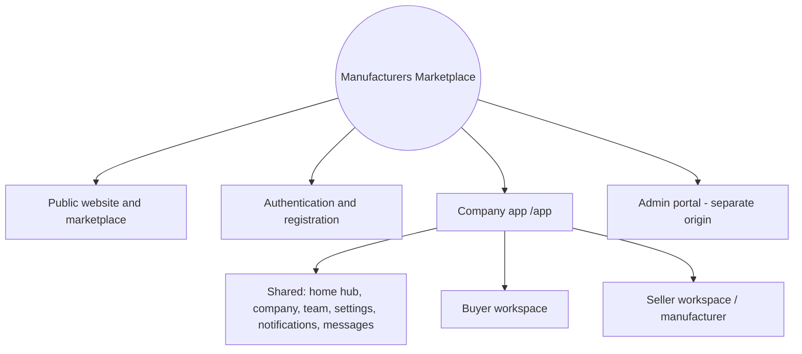
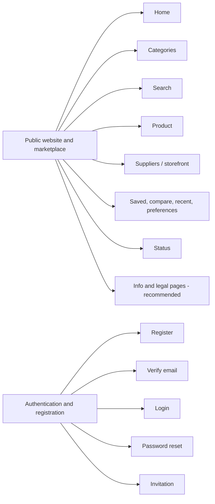
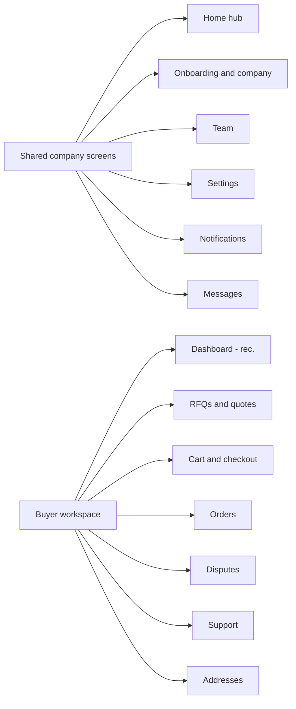
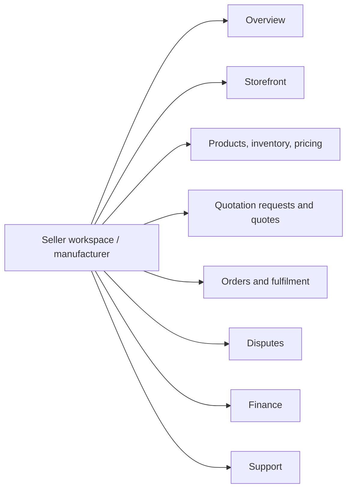
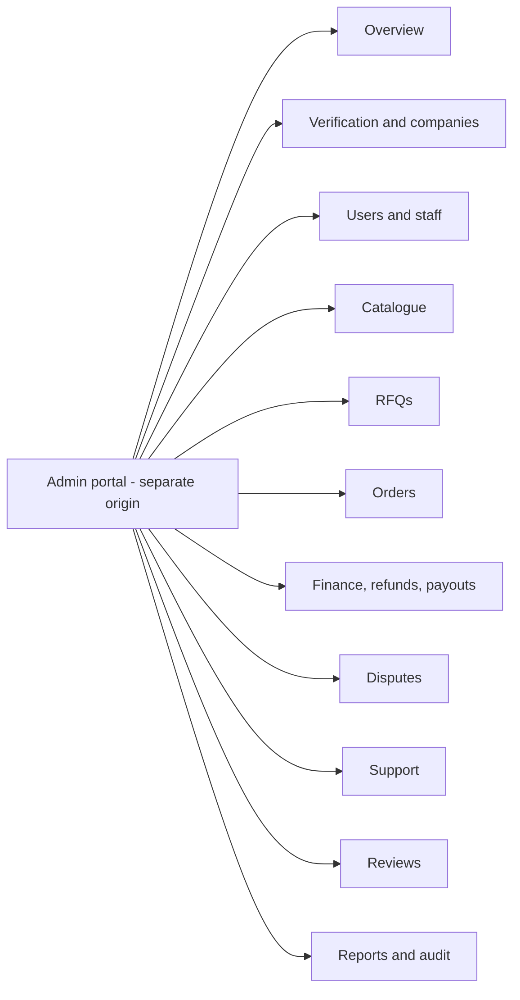

# 3. Application sitemap

All web routes are prefixed with the locale: `/en/...` or `/ar/...` (Arabic renders right-to-left). The admin portal is served from a **separate origin** (in development `admin.localhost:3000`; the host middleware in `apps/web/src/lib/hosts.ts` keeps company routes off the admin host and admin routes off the main host). `[workspaceId]`, `[id]` and similar segments are UUIDs. 93 `page.tsx` routes exist today; dialogs, drawers, tabs and sections are listed under their parent page.

Legend: **[S]** shared between user types, **(dialog)**, **(drawer)**, **(tab)**, **(section)**, **(overlay)**; status after the dash.

## 3.1 Overview

The top level has four parts. Each part is broken down in the diagrams that follow; the full hierarchy with screen IDs is in 3.4.

### Public website and authentication

### Company app: shared screens and buyer workspace

### Seller workspace (manufacturer / supplier)

### Admin portal (separate origin)

## 3.2 Supplier experience

The code has a single **seller workspace** used by manufacturers, factories, wholesalers, distributors, importers, authorised distributors and trading companies (the `BusinessType` enum). There is no separate supplier portal; "manufacturer experience" and "supplier experience" are the same screens. Business type only changes labels on cards and storefronts and the supplier filter.

## 3.3 Shared screens

| Screen | Shared by |
|---|---|
| Home hub ACC-01, settings ACC-13, notifications ACC-14, workspace switcher ACC-15 | All company users |
| Onboarding and company profile ACC-02…ACC-08, team ACC-09…ACC-12 | Buyer and seller owners |
| Messages MSG-01…MSG-04 | Buyer OWNER/PROCUREMENT and seller OWNER/SALES |
| Disputes SHR-01, SHR-02 | Buyer and seller workspaces (same component, different route) |
| Support SHR-03…SHR-06 | Buyer and seller workspaces |
| Marketplace pages PUB-01…PUB-15 | Guests, all company users (sellers browse as verified users) |
| Status badges, timeline, order lines | Buyer, seller and admin views of the same records (fields differ by role) |

## 3.4 Hierarchical sitemap by area

### Public-facing website

- **PUB-01** Marketplace home **[S]** — `/{locale}` — Implemented
- **PUB-02** Category directory **[S]** — `/{locale}/categories` — Implemented
- **PUB-03** Category page **[S]** — `/{locale}/categories/[id]` — Implemented
- **PUB-04** Search results **[S]** — `/{locale}/search?q=&…` — Implemented
  - **PUB-05** Filter panel / mobile filter sheet (overlay) **[S]** — `Overlay on PUB-03/PUB-04` — Partial
  - **PUB-06** Search suggestions dropdown (overlay) **[S]** — `Overlay on header search` — Implemented
- **PUB-07** Product detail **[S]** — `/{locale}/products/[id]` — Implemented
  - **PUB-08** Product image viewer (lightbox) (overlay) **[S]** — `Overlay on PUB-07` — Recommended
- **PUB-09** Supplier directory **[S]** — `/{locale}/suppliers` — Implemented
- **PUB-10** Supplier storefront (manufacturer profile) **[S]** — `/{locale}/suppliers/[id]` — Implemented
- **PUB-15** System status **[S]** — `/{locale}/status` — Implemented
- **PUB-16** About the platform — `/{locale}/about (recommended)` — Recommended
- **PUB-17** How it works — `/{locale}/how-it-works (recommended)` — Recommended
- **PUB-18** Pricing and fees — `/{locale}/pricing (recommended)` — Recommended
- **PUB-19** Frequently asked questions — `/{locale}/faq (recommended)` — Recommended
- **PUB-20** Help centre — `/{locale}/help (recommended)` — Recommended
- **PUB-21** Contact — `/{locale}/contact (recommended)` — Recommended
- **PUB-22** Terms and conditions — `/{locale}/legal/terms (recommended)` — Blocked
- **PUB-23** Privacy policy — `/{locale}/legal/privacy (recommended)` — Blocked
- **PUB-24** Returns, refunds and cancellation policy — `/{locale}/legal/returns (recommended)` — Blocked
- **PUB-25** Other policy pages (template) — `/{locale}/legal/[slug] (recommended)` — Blocked
- **PUB-26** Become a supplier — `/{locale}/sell (recommended)` — Recommended
- **PUB-27** Site footer and legal centre — `Global footer` — Recommended

### Public website: signed-in lists

- **PUB-11** Saved products and suppliers **[S]** — `/{locale}/saved` — Implemented
- **PUB-12** Product comparison **[S]** — `/{locale}/compare` — Implemented
- **PUB-13** Recently viewed **[S]** — `/{locale}/recent` — Implemented
- **PUB-14** Marketplace preferences **[S]** — `/{locale}/preferences` — Implemented

### Authentication and registration

- **AUTH-01** Create account (register) — `/{locale}/register` — Implemented
- **AUTH-02** Check your email — `/{locale}/register (success state)` — Implemented
- **AUTH-03** Verify email — `/{locale}/verify-email#token=…` — Implemented
- **AUTH-04** Sign in — `/{locale}/login?next=` — Implemented
- **AUTH-05** Forgot password — `/{locale}/forgot-password` — Implemented
- **AUTH-06** Reset password — `/{locale}/reset-password#token=…` — Implemented
- **AUTH-07** Email verification gate — `Any /app route before verification` — Implemented
- **AUTH-08** Accept team invitation — `/{locale}/invitations/accept#token=…` — Implemented
- **AUTH-09** Session expired / signed out — `Redirect to /{locale}/login?next=` — Partial

### Admin authentication (separate origin)

- **AUTH-10** Admin sign in — `/{locale}/admin/login (admin origin only)` — Implemented
- **AUTH-11** Admin MFA enrolment — `/{locale}/admin/mfa` — Implemented
- **AUTH-12** Admin recovery codes — `/{locale}/admin/mfa (step)` — Implemented
- **AUTH-13** Admin MFA verification — `/{locale}/admin/mfa (verify)` — Implemented

### Account management (shared)

- **ACC-01** Home (workspace hub) **[S]** — `/{locale}/app` — Implemented
- **ACC-02** Register a company (onboarding) **[S]** — `/{locale}/app/onboarding` — Implemented
- **ACC-03** Company profile and verification **[S]** — `/{locale}/app/company/[companyId]` — Implemented
- **ACC-04** Edit company details **[S]** — `Mode of ACC-03` — Implemented
  - **ACC-05** Verification document upload (section) **[S]** — `Section of ACC-03` — Implemented
  - **ACC-06** Submit for verification (terms) (section) **[S]** — `Section of ACC-03` — Implemented
  - **ACC-07** Licence renewal (section) **[S]** — `Section of ACC-03` — Implemented
  - **ACC-08** Remove document dialog (dialog) **[S]** — `Dialog on ACC-03` — Implemented
- **ACC-09** Team management **[S]** — `/{locale}/app/team/[workspaceId]` — Implemented
  - **ACC-10** Invite team member form (section) **[S]** — `Section of ACC-09` — Implemented
  - **ACC-11** Change role dialog (dialog) **[S]** — `Dialog on ACC-09` — Implemented
  - **ACC-12** Remove access dialog (dialog) **[S]** — `Dialog on ACC-09` — Implemented
- **ACC-13** Account settings **[S]** — `/{locale}/app/settings` — Implemented
- **ACC-15** Workspace switcher **[S]** — `Header control (all /app pages)` — Implemented
- **ACC-16** Account closure and data requests **[S]** — `Not built` — Planned
- **ACC-17** Billing, invoices and statements **[S]** — `Not built (spec /account/billing, /finance/invoices)` — Blocked

### Communication (shared)

- **ACC-14** Notification centre **[S]** — `/{locale}/app/notifications` — Implemented
- **MSG-01** Conversations list **[S]** — `/{locale}/app/messages/[workspaceId]` — Implemented
- **MSG-02** Conversation thread **[S]** — `/{locale}/app/messages/[workspaceId]/[conversationId]` — Implemented
- **MSG-03** New message to supplier **[S]** — `/{locale}/app/messages/new?storefront=…` — Implemented
  - **MSG-04** Message attachments (section) **[S]** — `Part of MSG-02` — Planned

### Buyer experience

- **BUY-01** Buyer dashboard — `/{locale}/app/buyer/[workspaceId]` — Recommended
- **BUY-02** Requests for quotation list — `/{locale}/app/buyer/[workspaceId]/rfqs` — Implemented
- **BUY-03** New request for quotation — `/{locale}/app/buyer/[workspaceId]/rfqs/new` — Implemented
- **BUY-04** Request quotation entry (workspace chooser) — `/{locale}/app/rfqs/new` — Implemented
- **BUY-05** Request for quotation detail (buyer) — `/{locale}/app/buyer/[workspaceId]/rfqs/[rfqId]` — Implemented
- **BUY-06** Edit request draft — `/{locale}/app/buyer/[workspaceId]/rfqs/[rfqId] (edit mode)` — Implemented
  - **BUY-07** Publish request dialog (dialog) — `Dialog on BUY-05` — Implemented
  - **BUY-08** Cancel request dialog (dialog) — `Dialog on BUY-05` — Implemented
  - **BUY-09** Invite suppliers picker (section) — `Panel in BUY-03/BUY-06` — Implemented
  - **BUY-10** Quote comparison (section) — `Section of BUY-05` — Implemented
  - **BUY-11** Quote detail and version history (section) — `Expandable within BUY-05` — Implemented
  - **BUY-12** Accept quote dialog (dialog) — `Dialog on BUY-05` — Implemented
  - **BUY-13** Request revision dialog (dialog) — `Dialog on BUY-05` — Implemented
  - **BUY-14** Decline quote dialog (dialog) — `Dialog on BUY-05` — Implemented
  - **BUY-15** Counteroffer to supplier (dialog) — `Dialog on BUY-05 (proposed)` — Planned
- **BUY-16** Cart — `/{locale}/app/buyer/[workspaceId]/cart` — Implemented
- **BUY-17** Checkout — `/{locale}/app/buyer/[workspaceId]/checkout` — Implemented
- **BUY-18** Checkout status and payment — `/{locale}/app/buyer/[workspaceId]/checkouts/[checkoutId]` — Implemented
  - **BUY-19** Cancel checkout dialog (dialog) — `Dialog on BUY-18` — Implemented
- **BUY-20** Delivery addresses — `/{locale}/app/buyer/[workspaceId]/addresses` — Implemented
  - **BUY-21** Address form (section) — `Form on BUY-20` — Implemented
  - **BUY-22** Remove address dialog (dialog) — `Dialog on BUY-20` — Implemented
- **BUY-23** Orders list (buyer) — `/{locale}/app/buyer/[workspaceId]/orders` — Implemented
- **BUY-24** Order detail (buyer) — `/{locale}/app/buyer/[workspaceId]/orders/[orderId]` — Implemented
  - **BUY-25** Confirm receipt dialog (dialog) — `Dialog on BUY-24` — Implemented
  - **BUY-26** Rate supplier form (section) — `Section of BUY-24` — Implemented
  - **BUY-27** Open dispute form (buyer) (dialog) — `Dialog on BUY-24` — Implemented
- **BUY-28** Invoices and tax documents (buyer) — `/{locale}/app/buyer/[workspaceId]/invoices (proposed)` — Blocked
- **BUY-29** Payment history (buyer) — `/{locale}/app/buyer/[workspaceId]/payments (proposed)` — Recommended
  - **BUY-30** Reorder (action) — `Action on BUY-24 (proposed)` — Planned
  - **BUY-31** Request order cancellation (buyer) (dialog) — `Dialog on BUY-24 (proposed)` — Planned
  - **BUY-32** Request a sample (action) — `Action on PUB-07 (proposed)` — Recommended

### Customer support and disputes (shared)

- **SHR-01** Disputes list **[S]** — `/{locale}/app/buyer/[workspaceId]/disputes and /{locale}/app/seller/[workspaceId]/disputes` — Implemented
- **SHR-02** Dispute detail **[S]** — `/{locale}/app/buyer/[workspaceId]/disputes/[disputeId] and /{locale}/app/seller/[workspaceId]/disputes/[disputeId]` — Implemented
- **SHR-03** Support tickets list **[S]** — `/{locale}/app/buyer/[workspaceId]/support and /{locale}/app/seller/[workspaceId]/support` — Implemented
- **SHR-04** New support ticket **[S]** — `/{locale}/app/buyer/[workspaceId]/support/new and /{locale}/app/seller/[workspaceId]/support/new` — Implemented
- **SHR-05** Support ticket detail **[S]** — `/{locale}/app/buyer/[workspaceId]/support/[ticketId] and /{locale}/app/seller/[workspaceId]/support/[ticketId]` — Implemented
  - **SHR-06** Close or reopen ticket dialog (dialog) **[S]** — `Dialog on SHR-05` — Implemented

### Finance and payment (payment pages)

- **FIN-01** Sandbox payment page — `/{locale}/sandbox-pay/[sessionId]` — Implemented
  - **FIN-02** Live payment provider checkout (external page) — `Provider-hosted page (external)` — Blocked
- **FIN-03** Bank transfer instructions — `/{locale}/app/buyer/[workspaceId]/checkouts/[checkoutId] (proposed state)` — Blocked

### Manufacturer / supplier experience

- **SEL-01** Seller overview (dashboard) — `/{locale}/app/seller/[workspaceId]` — Implemented
- **SEL-02** Storefront editor — `/{locale}/app/seller/[workspaceId]/storefront` — Implemented
  - **SEL-03** Storefront media manager (section) — `Section of SEL-02` — Implemented
  - **SEL-04** Delivery terms (section) — `Section of SEL-02` — Implemented
  - **SEL-05** Publish or take storefront offline dialog (dialog) — `Dialog on SEL-02` — Implemented
- **SEL-06** Product list — `/{locale}/app/seller/[workspaceId]/products` — Implemented
- **SEL-07** Add product — `/{locale}/app/seller/[workspaceId]/products/new` — Implemented
- **SEL-08** Product editor (content) — `/{locale}/app/seller/[workspaceId]/products/[productId]` — Implemented
  - **SEL-09** Product media manager (section) — `Section of SEL-08` — Implemented
  - **SEL-10** Variants (SKU) manager (section) — `Section of SEL-08` — Implemented
  - **SEL-11** Product pricing editor (section) — `Section of SEL-08` — Implemented
  - **SEL-12** Submit for review dialog (dialog) — `Dialog on SEL-08` — Implemented
  - **SEL-13** Listing lifecycle dialogs (dialog) — `Dialogs on SEL-08` — Implemented
  - **SEL-14** Moderation history (section) — `Section of SEL-08` — Implemented
- **SEL-15** Inventory — `/{locale}/app/seller/[workspaceId]/inventory` — Implemented
  - **SEL-16** Stock adjustment dialog (dialog) — `Dialog on SEL-15` — Implemented
  - **SEL-17** Low-stock threshold and restock date (section) — `Inline form on SEL-15` — Implemented
  - **SEL-18** Stock movement history (drawer) — `Drawer on SEL-15` — Implemented
- **SEL-19** Pricing overview — `/{locale}/app/seller/[workspaceId]/pricing` — Implemented
- **SEL-20** Quotation requests inbox — `/{locale}/app/seller/[workspaceId]/rfqs` — Implemented
- **SEL-21** Request detail (seller) — `/{locale}/app/seller/[workspaceId]/rfqs/[rfqId]` — Implemented
  - **SEL-22** Quote form (section) — `Form on SEL-21` — Implemented
  - **SEL-23** Submit quote dialog (dialog) — `Dialog on SEL-21` — Implemented
  - **SEL-24** Withdraw quote dialog (dialog) — `Dialog on SEL-21` — Implemented
  - **SEL-25** Ask the buyer a question (dialog) — `Dialog on SEL-21` — Implemented
- **SEL-26** Quotes list (seller) — `/{locale}/app/seller/[workspaceId]/quotes` — Implemented
- **SEL-27** Orders list (seller) — `/{locale}/app/seller/[workspaceId]/orders` — Implemented
- **SEL-28** Order detail (seller) — `/{locale}/app/seller/[workspaceId]/orders/[orderId]` — Implemented
  - **SEL-29** Record dispatch dialog (dialog) — `Dialog on SEL-28` — Implemented
  - **SEL-30** Report delivery dialog (dialog) — `Dialog on SEL-28` — Implemented
  - **SEL-31** Open dispute (seller) (dialog) — `Dialog on SEL-28` — Implemented
- **SEL-32** Seller finance — `/{locale}/app/seller/[workspaceId]/finance` — Implemented
- **SEL-33** Payout account onboarding — `/{locale}/app/seller/[workspaceId]/finance/payout-account (proposed)` — Blocked
- **SEL-34** Statements and commission invoices — `/{locale}/app/seller/[workspaceId]/finance/statements (proposed)` — Blocked
- **SEL-35** Seller analytics — `/{locale}/app/seller/[workspaceId]/analytics (proposed)` — Planned
  - **SEL-36** Supplier order cancellation (dialog) — `Dialog on SEL-28 (proposed)` — Planned
- **SEL-37** Returns handling — `/{locale}/app/seller/[workspaceId]/returns (proposed)` — Planned
  - **SEL-38** Production milestones (made to order) (section) — `Section of SEL-28 (proposed)` — Recommended

### Administration portal (incl. finance management)

- **ADM-01** Admin overview and operations — `/{locale}/admin` — Implemented
- **ADM-02** Verification queue — `/{locale}/admin/verification` — Implemented
- **ADM-03** Verification case detail — `/{locale}/admin/verification/[caseId]` — Implemented
  - **ADM-04** Verification decision dialog (dialog) — `Dialog on ADM-03` — Implemented
- **ADM-05** Companies — `/{locale}/admin/companies` — Implemented
- **ADM-06** Company detail (admin) — `/{locale}/admin/companies/[companyId]` — Implemented
  - **ADM-07** Suspend or reactivate company dialog (dialog) — `Dialog on ADM-06` — Implemented
- **ADM-08** Users — `/{locale}/admin/users` — Implemented
  - **ADM-09** Revoke sessions dialog (dialog) — `Dialog on ADM-08` — Implemented
- **ADM-10** Catalogue moderation overview — `/{locale}/admin/catalog` — Implemented
- **ADM-11** Moderation queue — `/{locale}/admin/catalog (queue section)` — Implemented
- **ADM-12** Listing version review (diff) — `/{locale}/admin/catalog/reviews/[versionId]` — Implemented
  - **ADM-13** Review decision dialog (dialog) — `Dialog on ADM-12` — Implemented
- **ADM-14** All listings — `/{locale}/admin/catalog/products` — Implemented
- **ADM-15** Listing detail (admin) — `/{locale}/admin/catalog/products/[id]` — Implemented
  - **ADM-16** Listing enforcement dialog (dialog) — `Dialog on ADM-15` — Implemented
- **ADM-17** Storefront oversight — `/{locale}/admin/catalog/storefronts` — Implemented
- **ADM-18** Storefront detail (admin) — `/{locale}/admin/catalog/storefronts/[id] (proposed)` — Planned
  - **ADM-19** Hide or restore storefront dialog (dialog) — `Dialog on ADM-17` — Implemented
- **ADM-20** Categories — `/{locale}/admin/catalog/categories` — Implemented
- **ADM-21** Category editor — `/{locale}/admin/catalog/categories/[id]` — Implemented
  - **ADM-22** Category attribute editor (dialog) — `Dialog on ADM-21` — Implemented
- **ADM-23** Restricted and prohibited terms — `/{locale}/admin/catalog/restricted` — Implemented
- **ADM-24** Featured placements — `/{locale}/admin/catalog/featured` — Implemented
- **ADM-25** RFQ oversight — `/{locale}/admin/rfqs` — Implemented
- **ADM-26** RFQ detail (admin) — `/{locale}/admin/rfqs/[id]` — Implemented
  - **ADM-27** Hide or unhide RFQ dialog (dialog) — `Dialog on ADM-26` — Implemented
- **ADM-28** Orders (admin) — `/{locale}/admin/orders` — Implemented
- **ADM-29** Order detail (admin) — `/{locale}/admin/orders/[orderId]` — Implemented
- **ADM-30** Finance overview — `/{locale}/admin/finance` — Implemented
- **ADM-31** Reconciliation case resolution — `/{locale}/admin/finance/reconciliation/[id] (proposed)` — Planned
- **ADM-32** Refunds — `/{locale}/admin/refunds` — Implemented
  - **ADM-33** Request refund form (section) — `Form on ADM-32` — Partial
  - **ADM-34** Approve or reject refund dialog (dialog) — `Dialog on ADM-32` — Implemented
- **ADM-35** Payouts — `/{locale}/admin/payouts` — Implemented
  - **ADM-36** Request payout dialog (dialog) — `Dialog on ADM-35` — Implemented
  - **ADM-37** Approve or reject payout dialog (dialog) — `Dialog on ADM-35` — Implemented
- **ADM-38** Disputes queue — `/{locale}/admin/disputes` — Implemented
- **ADM-39** Dispute detail (admin) — `/{locale}/admin/disputes/[disputeId]` — Implemented
  - **ADM-40** Dispute action dialogs (dialog) — `Dialogs on ADM-39` — Implemented
- **ADM-41** Supplier reviews moderation — `/{locale}/admin/supplier-reviews` — Implemented
- **ADM-42** Support queue — `/{locale}/admin/support` — Implemented
- **ADM-43** Ticket detail (admin) — `/{locale}/admin/support/[ticketId]` — Implemented
- **ADM-44** Reports (scoped CSV exports) — `/{locale}/admin/reports` — Implemented
- **ADM-45** Audit log — `/{locale}/admin/audit` — Implemented
- **ADM-46** Staff and roles — `/{locale}/admin/staff` — Implemented
- **ADM-47** Platform settings and commission — `/{locale}/admin/settings (proposed)` — Planned
- **ADM-48** Logistics and delivery settings — `/{locale}/admin/logistics (proposed)` — Planned
- **ADM-49** System health and webhooks — `/{locale}/admin/system (proposed)` — Recommended
- **ADM-50** Tax configuration and invoicing — `/{locale}/admin/tax (proposed)` — Blocked
- **ADM-51** Data requests, account closure and legal hold — `/{locale}/admin/data-requests (proposed)` — Planned
- **ADM-52** Executive analytics — `/{locale}/admin/analytics (proposed)` — Recommended
  - **ADM-53** Sandbox provider simulator (action) — `Action on ADM-32 / ADM-35` — Implemented

### System screens (all areas)

- **SYS-01** Not found / not available **[S]** — `Any unknown or inaccessible resource` — Implemented
- **SYS-02** Error with retry and reference **[S]** — `Any failed load or action` — Implemented
- **SYS-03** Sandbox environment banner **[S]** — `Global (top of every page)` — Implemented
- **SYS-04** Trading unavailable / maintenance **[S]** — `Recommended` — Recommended
