# 5. Detailed user journeys

31 journeys, one per item requested in the brief. Each lists start point, steps, screens (IDs from section 4), decisions, system responses, outcomes, failures, alternatives and permissions, with a Mermaid diagram. The journey status says how much of it works today.

| ID | Journey | Roles | Status |
|---|---|---|---|
| J-01 | Visiting the marketplace for the first time | Guest | Implemented |
| J-02 | Creating a buyer account | Guest → buyer OWNER | Implemented |
| J-03 | Creating a manufacturer account | Guest → seller OWNER | Implemented |
| J-04 | Business verification (company side) | Company OWNER | Implemented |
| J-05 | Manufacturer onboarding (after approval) | Seller OWNER | Implemented |
| J-06 | Creating a manufacturer storefront | Seller OWNER, SALES | Implemented |
| J-07 | Creating and managing product listings | Seller OWNER, SALES (WAREHOUSE for stock) | Implemented |
| J-08 | Searching for manufacturers | Guest, verified user | Implemented |
| J-09 | Searching for products | Guest, verified user | Implemented |
| J-10 | Browsing categories | Guest, verified user | Implemented |
| J-11 | Viewing manufacturer profiles | Guest, verified user, approved buyer | Implemented |
| J-12 | Submitting a request for quotation | Buyer OWNER, PROCUREMENT | Implemented |
| J-13 | Receiving quotations | Buyer OWNER, PROCUREMENT; seller OWNER, SALES | Implemented |
| J-14 | Comparing quotations | Buyer OWNER, PROCUREMENT, VIEWER | Implemented |
| J-15 | Accepting or rejecting quotations | Buyer OWNER, PROCUREMENT | Implemented |
| J-16 | Creating an order | Buyer OWNER, PROCUREMENT | Implemented |
| J-17 | Completing checkout | Buyer OWNER, PROCUREMENT | Implemented |
| J-18 | Making payments | Buyer OWNER, PROCUREMENT | Partial (sandbox only) |
| J-19 | Managing production | Seller OWNER, SALES, WAREHOUSE | Partial |
| J-20 | Tracking order progress | Buyer OWNER, PROCUREMENT, VIEWER | Implemented |
| J-21 | Managing fulfilment | Seller OWNER, SALES, WAREHOUSE | Implemented |
| J-22 | Confirming order completion | Buyer OWNER, PROCUREMENT | Implemented (auto-complete pending decision) |
| J-23 | Requesting cancellations | Buyer, seller | Partial |
| J-24 | Requesting refunds | Buyer (via dispute), finance | Implemented (sandbox) |
| J-25 | Opening disputes | Buyer OWNER, PROCUREMENT; seller | Implemented |
| J-26 | Resolving disputes | Platform SUPPORT, FINANCE | Implemented (sandbox refunds) |
| J-27 | Receiving payouts | Seller OWNER, FINANCE; platform finance | Implemented (sandbox, manual) |
| J-28 | Contacting customer support | Any workspace member (not VIEWER for writing) | Implemented |
| J-29 | Managing account settings | Any company user | Implemented |
| J-30 | Administrative approval and verification | Platform COMPLIANCE | Implemented |
| J-31 | Financial reconciliation | Platform FINANCE, FINANCE_APPROVER | Partial (cases visible; no resolution) |


## J-01 · Visiting the marketplace for the first time

**Roles:** Guest · **Status:** Implemented

**Starting point:** Direct link, search engine or shared product URL → /en or /ar (PUB-01).

**Steps:**

1. Lands on home; sees sandbox banner (development), hero, live totals, featured categories/products/suppliers.
2. Uses search (suggestions after 2 characters) or opens a category.
3. Browses results; prices are hidden with "Sign in with a verified email to see wholesale prices".
4. Opens a product; trade buttons are disabled with a reason (sign in).
5. Chooses Create account or Sign in, or switches language (EN/AR) at any time.

| Aspect | Detail |
|---|---|
| Required screens | PUB-01, PUB-06, PUB-02, PUB-03, PUB-04, PUB-07, PUB-10, AUTH-01, AUTH-04 |
| User decisions | Search vs browse; switch language; register now or keep browsing. |
| System responses | Server renders public listings only (marketplace views); guests receive 422 on price filters, so UI hides them. |
| Success outcome | Visitor understands the verified-supplier promise and starts registration or a search. |
| Failure scenarios | Search returns no results ("No products match these filters."); API error shows retry with reference ID. |
| Alternative pathways | Enter from a storefront link (PUB-10) or category link (PUB-03). |
| Permissions and restrictions | Public. Prices and saved lists need a verified email (A12). |


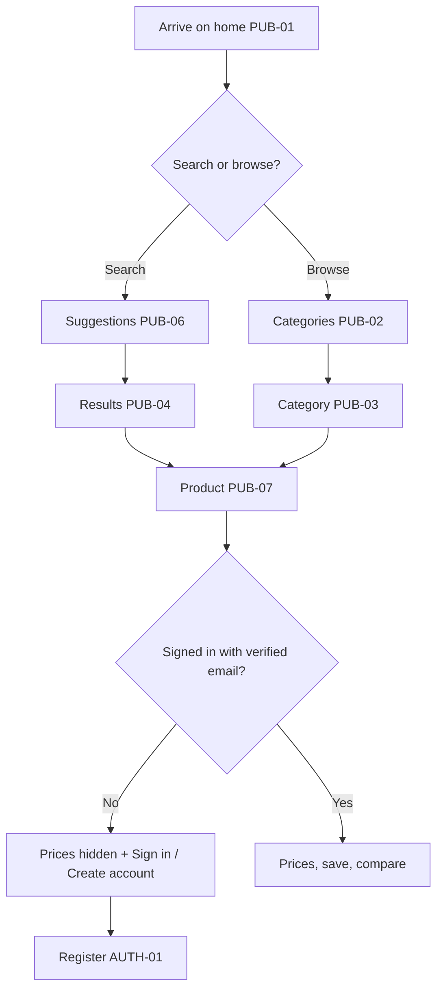

## J-02 · Creating a buyer account

**Roles:** Guest → buyer OWNER · **Status:** Implemented

**Starting point:** Create account (AUTH-01) from header, product or RFQ button.

**Steps:**

1. Enters name, email, password (12–128), locale; accepts terms (version "dev-1" placeholder).
2. Sees "Check your email" (AUTH-02); clicks the link (AUTH-03).
3. Signs in (AUTH-04); lands on Home (ACC-01) showing "Register your company".
4. Registers company as buyer in onboarding (ACC-02) → J-04 verification.

| Aspect | Detail |
|---|---|
| Required screens | AUTH-01, AUTH-02, AUTH-03, AUTH-04, ACC-01, ACC-02 |
| User decisions | Register as buyer, seller or both (company kinds). |
| System responses | Argon2id hashing, enumeration-safe responses (account_exists email), verification token, server session in PostgreSQL. |
| Success outcome | Verified user with a DRAFT company and PENDING buyer workspace. |
| Failure scenarios | Weak/short password, invalid email, expired verification link (resend), rate limit. |
| Alternative pathways | Accept an invitation instead (AUTH-08) to join an existing company. |
| Permissions and restrictions | Self-registration only for company users; no admin registration (D03). |


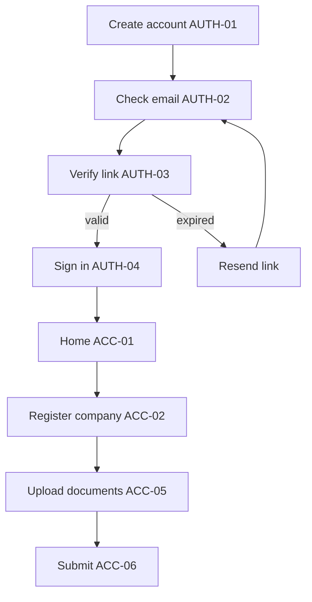

## J-03 · Creating a manufacturer account

**Roles:** Guest → seller OWNER · **Status:** Implemented

**Starting point:** Create account (AUTH-01); "Become a supplier" landing (PUB-26) is recommended but missing.

**Steps:**

1. Same account steps as J-02.
2. In onboarding (ACC-02) selects seller kind (or both), business type and licence details.
3. Uploads licence and documents; submits for verification.
4. Seller centre is visible but listing is paused until approval ("Listing is paused: {reason}").

| Aspect | Detail |
|---|---|
| Required screens | PUB-26, AUTH-01, ACC-02, ACC-05, ACC-06, SEL-01 |
| User decisions | Seller only or buyer + seller. |
| System responses | Creates company + seller workspace (PENDING); trading capabilities removed until ACTIVE. |
| Success outcome | Seller account awaiting verification. |
| Failure scenarios | As J-02; missing documents block submission. |
| Alternative pathways | Join an existing seller company by invitation. |
| Permissions and restrictions | As J-02. |


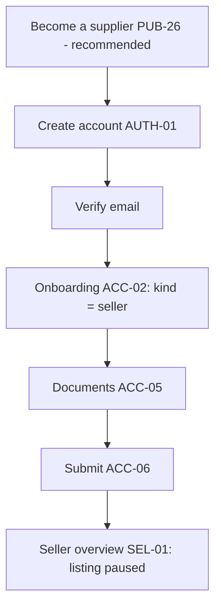

## J-04 · Business verification (company side)

**Roles:** Company OWNER · **Status:** Implemented

**Starting point:** Company profile (ACC-03) after onboarding.

**Steps:**

1. Completes company details (ACC-04): legal/display name, licence number, issuer, expiry, activity, TRN (15 digits, optional), address.
2. Uploads documents (PDF/PNG/JPEG ≤10 MB); each is malware-scanned (Pending → Clean or blocked).
3. Opens Submit (ACC-06), accepts terms, submits → SUBMITTED.
4. Waits: UNDER_REVIEW → APPROVED / NEEDS_INFO / REJECTED with email + notification.
5. If NEEDS_INFO: edits and resubmits. Before expiry: renewal (ACC-07).

| Aspect | Detail |
|---|---|
| Required screens | ACC-03, ACC-04, ACC-05, ACC-06, ACC-07, ACC-08 |
| User decisions | Submit now or save draft; respond to info request. |
| System responses | Status machine DRAFT→SUBMITTED→UNDER_REVIEW→(APPROVED\|NEEDS_INFO\|REJECTED); approval activates workspaces (D08). |
| Success outcome | APPROVED company; workspaces ACTIVE; trading unlocked. |
| Failure scenarios | Infected file blocked; missing required documents; REJECTED with reason; licence expired → SUSPENDED (LICENCE_EXPIRED). |
| Alternative pathways | Renewal case (kind RENEWAL) for licence updates. |
| Permissions and restrictions | company.manage (OWNER). |


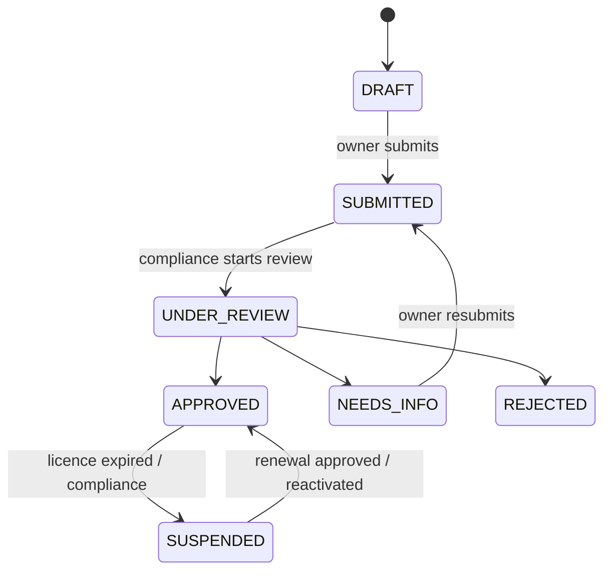

## J-05 · Manufacturer onboarding (after approval)

**Roles:** Seller OWNER · **Status:** Implemented

**Starting point:** Approval email → Seller overview (SEL-01).

**Steps:**

1. Invites team (ACC-09/ACC-10) with roles SALES, WAREHOUSE, FINANCE, VIEWER.
2. Builds storefront (SEL-02) and media (SEL-03); sets delivery terms (SEL-04).
3. Publishes storefront (SEL-05).
4. Adds first product (SEL-07) → J-07.

| Aspect | Detail |
|---|---|
| Required screens | SEL-01, ACC-09, ACC-10, SEL-02, SEL-03, SEL-04, SEL-05, SEL-07 |
| User decisions | Which roles to invite; publish storefront before or after products. |
| System responses | Eligibility check (approved company, valid licence) on publish. |
| Success outcome | Live storefront and team in place. |
| Failure scenarios | Publish blocked by missing required fields or ineligibility. |
| Alternative pathways | Skip team invites (owner acts alone). |
| Permissions and restrictions | company.manage for invites; seller.catalog.edit for storefront. |


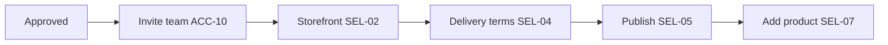

## J-06 · Creating a manufacturer storefront

**Roles:** Seller OWNER, SALES · **Status:** Implemented

**Starting point:** Seller nav › Storefront (SEL-02).

**Steps:**

1. Fills About, Capabilities, Services, Fulfilment, Certifications (bilingual).
2. Uploads logo, cover, factory/warehouse images.
3. Saves (concurrency-safe).
4. Publishes; storefront becomes public at /suppliers/[id].

| Aspect | Detail |
|---|---|
| Required screens | SEL-02, SEL-03, SEL-05, PUB-10 |
| User decisions | Which optional sections to fill; Arabic content. |
| System responses | Storefronts are not pre-moderated; admin can hide with reason. |
| Success outcome | Public storefront (PUB-10). |
| Failure scenarios | Hidden by marketplace team (reason shown); upload errors. |
| Alternative pathways | Take offline at any time. |
| Permissions and restrictions | seller.catalog.edit; trading-gated. |


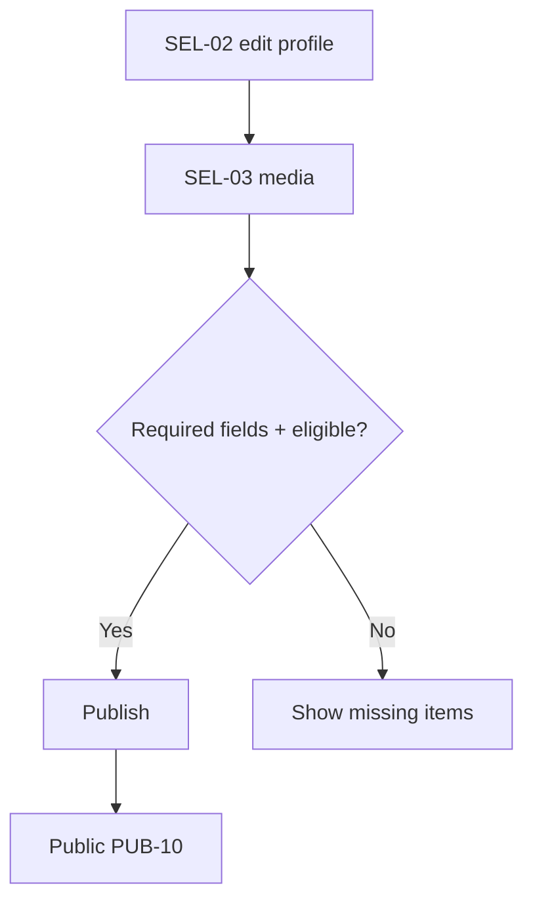

## J-07 · Creating and managing product listings

**Roles:** Seller OWNER, SALES (WAREHOUSE for stock) · **Status:** Implemented

**Starting point:** Add product (SEL-07) or product list (SEL-06).

**Steps:**

1. Creates draft (title, category, mode, first SKU, unit).
2. Completes content, attributes, specifications, media, variants (SEL-08–SEL-10).
3. Sets pricing (SEL-11): FIXED, TIERED or QUOTE_ONLY; MOQ; increment. Live immediately.
4. Submits for review (SEL-12) → PENDING_REVIEW; restricted-term screening.
5. Admin approves/rejects/requests changes → seller notified; approved → PUBLISHED.
6. Manages stock (SEL-15/16); edits create new draft versions; lifecycle actions (SEL-13).

| Aspect | Detail |
|---|---|
| Required screens | SEL-06, SEL-07, SEL-08, SEL-09, SEL-10, SEL-11, SEL-12, SEL-13, SEL-14, SEL-15, SEL-16 |
| User decisions | Ready stock vs made to order; price type; when to submit. |
| System responses | Versioned content; moderation queue; pricing changes audited without review. |
| Success outcome | Published listing visible in search. |
| Failure scenarios | REJECTED or CHANGES_REQUESTED with reason; BLOCKED category; restricted terms. |
| Alternative pathways | Duplicate an existing product; withdraw a submission. |
| Permissions and restrictions | seller.catalog.edit; stock seller.inventory.ship. |


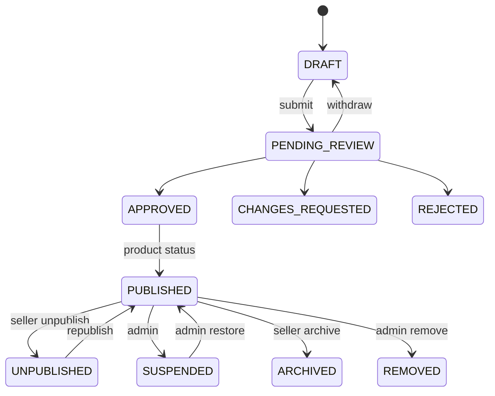

## J-08 · Searching for manufacturers

**Roles:** Guest, verified user · **Status:** Implemented

**Starting point:** Marketplace sub-nav › Suppliers (PUB-09).

**Steps:**

1. Filters by category, emirate, business type, capabilities (custom, private/white label, samples).
2. Opens a supplier card → storefront (PUB-10).
3. Saves supplier (verified users).

| Aspect | Detail |
|---|---|
| Required screens | PUB-09, PUB-10, PUB-11 |
| User decisions | Filter choices; save or contact. |
| System responses | Only public storefronts of eligible companies. |
| Success outcome | Shortlisted supplier. |
| Failure scenarios | "No suppliers match these filters." |
| Alternative pathways | Search by name via header suggestions. |
| Permissions and restrictions | Public; save requires verified email. |


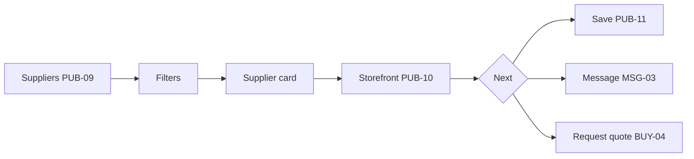

## J-09 · Searching for products

**Roles:** Guest, verified user · **Status:** Implemented

**Starting point:** Header search (PUB-06) → results (PUB-04).

**Steps:**

1. Types query; picks suggestion or submits.
2. Applies filters (mode, supplier type, emirate, price for verified, MOQ, lead time, dispatch, in stock, customisation, attributes).
3. Sorts (relevance, newest, price, lowest MOQ).
4. Switches grid/list; loads more.
5. Opens product; saves or compares.

| Aspect | Detail |
|---|---|
| Required screens | PUB-06, PUB-04, PUB-05, PUB-07, PUB-12 |
| User decisions | Filters and sort. |
| System responses | Trigram EN/AR search with Arabic normalisation. |
| Success outcome | Relevant product found. |
| Failure scenarios | No results; guest price filter blocked. |
| Alternative pathways | Browse categories (J-10). |
| Permissions and restrictions | Public; price filters verified only. |


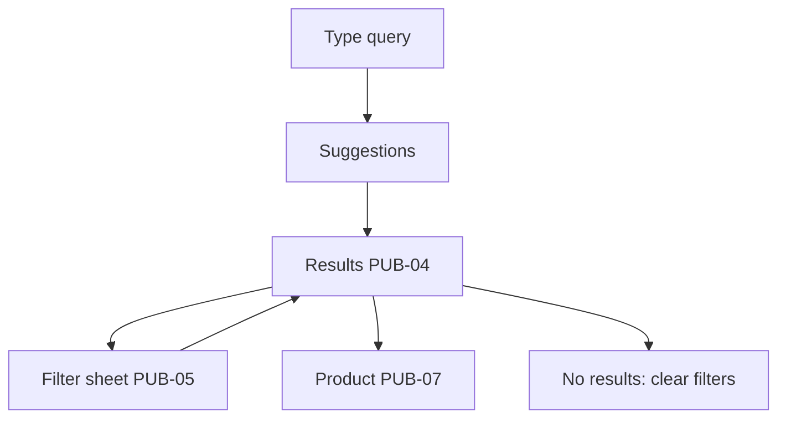

## J-10 · Browsing categories

**Roles:** Guest, verified user · **Status:** Implemented

**Starting point:** Home category tiles or Categories (PUB-02).

**Steps:**

1. Opens directory; chooses category or subcategory.
2. Reads supplier requirements (REVIEW_REQUIRED categories).
3. Filters by category attributes; opens product.

| Aspect | Detail |
|---|---|
| Required screens | PUB-02, PUB-03, PUB-04, PUB-07 |
| User decisions | Which subcategory. |
| System responses | Admin-managed tree; BLOCKED/hidden categories not shown. |
| Success outcome | Product shortlist. |
| Failure scenarios | Empty category. |
| Alternative pathways | Search inside category. |
| Permissions and restrictions | Public. |


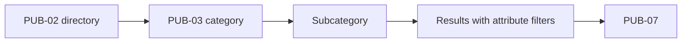

## J-11 · Viewing manufacturer profiles

**Roles:** Guest, verified user, approved buyer · **Status:** Implemented

**Starting point:** Supplier card, product supplier card or link.

**Steps:**

1. Reads about, capabilities, capacity, facilities, certifications (declared), year established, verified since.
2. Browses catalogue; reads anonymised reviews and average.
3. Acts: save, message (approved buyers), request quotation.

| Aspect | Detail |
|---|---|
| Required screens | PUB-10, MSG-03, BUY-04 |
| User decisions | Contact or request quote. |
| System responses | Contact details, documents and bank information are never public. |
| Success outcome | Buyer decides to engage. |
| Failure scenarios | Storefront hidden or not public → not found. |
| Alternative pathways | Compare products from the supplier. |
| Permissions and restrictions | Messaging and RFQ need approved buyer roles. |


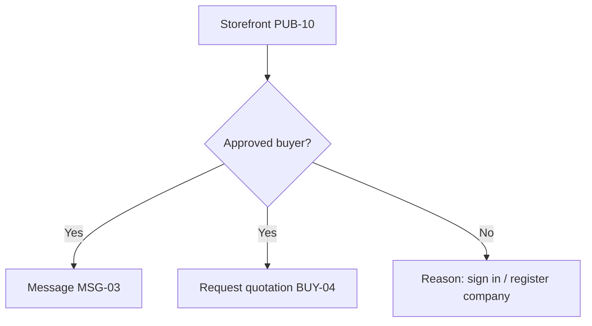

## J-12 · Submitting a request for quotation

**Roles:** Buyer OWNER, PROCUREMENT · **Status:** Implemented

**Starting point:** RFQs (BUY-02) › New request, or "Request quotation" on product/storefront (BUY-04).

**Steps:**

1. Fills title, category, quantity + unit, specifications, delivery emirate, needed by, deadline (Dubai), visibility, budget.
2. Invites suppliers (≤20) and attaches files (≤5).
3. Saves draft → reviews detail (BUY-05).
4. Publishes (BUY-07) → OPEN; invited and matching suppliers notified.

| Aspect | Detail |
|---|---|
| Required screens | BUY-02, BUY-03, BUY-04, BUY-05, BUY-06, BUY-07, BUY-08, BUY-09 |
| User decisions | POOL vs INVITE; budget disclosure; deadline. |
| System responses | Validates category, dates, limits (≤50 open); notifies sellers (rfq.invited / rfq.matched). |
| Success outcome | OPEN RFQ visible to eligible suppliers. |
| Failure scenarios | Validation errors; deadline too soon; hidden by platform; no eligible suppliers. |
| Alternative pathways | Edit draft; cancel (BUY-08). |
| Permissions and restrictions | buyer.purchase in ACTIVE workspace. |


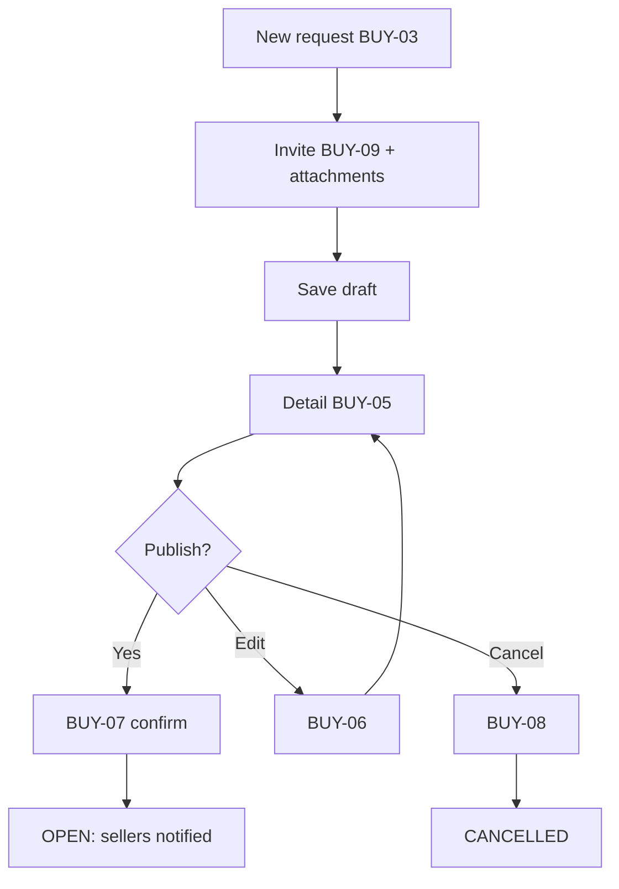

## J-13 · Receiving quotations

**Roles:** Buyer OWNER, PROCUREMENT; seller OWNER, SALES · **Status:** Implemented

**Starting point:** Seller notification rfq.invited/matched → SEL-21.

**Steps:**

1. Seller opens request, prepares quote draft (SEL-22) with prices, shipping, tax treatment, lead time, validity, deviations, terms, files.
2. Submits (SEL-23) → SUBMITTED; buyer notified (quote.submitted).
3. Buyer sees quote in comparison (BUY-10).

| Aspect | Detail |
|---|---|
| Required screens | SEL-20, SEL-21, SEL-22, SEL-23, SEL-25, BUY-05, BUY-10 |
| User decisions | Seller: quote or ask a question (SEL-25). |
| System responses | Server computes subtotal, tax and total; submitted versions immutable. |
| Success outcome | Buyer has quotes to compare. |
| Failure scenarios | Deadline passed; RFQ hidden or cancelled; validation. |
| Alternative pathways | Seller withdraws (SEL-24). |
| Permissions and restrictions | Seller: seller.catalog.edit; never sees other sellers' quotes. |


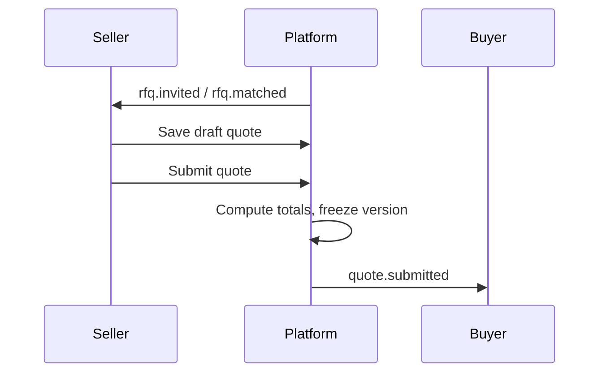

## J-14 · Comparing quotations

**Roles:** Buyer OWNER, PROCUREMENT, VIEWER · **Status:** Implemented

**Starting point:** RFQ detail (BUY-05) comparison section.

**Steps:**

1. Reviews current version per supplier: unit price, subtotal, shipping, tax, total, lead time, delivery date, validity, deviations.
2. Spots "Lowest total" marker.
3. Expands details and earlier versions (BUY-11).
4. Requests revision (BUY-13) or proceeds to accept/decline.

| Aspect | Detail |
|---|---|
| Required screens | BUY-10, BUY-11, BUY-13, BUY-15 |
| User decisions | Which supplier; whether to revise. |
| System responses | Totals from submitted versions only. |
| Success outcome | Buyer chooses a quote. |
| Failure scenarios | Quotes expire; supplier withdraws. |
| Alternative pathways | Counteroffer (BUY-15, planned). |
| Permissions and restrictions | Read for any member; actions buyer.purchase. |


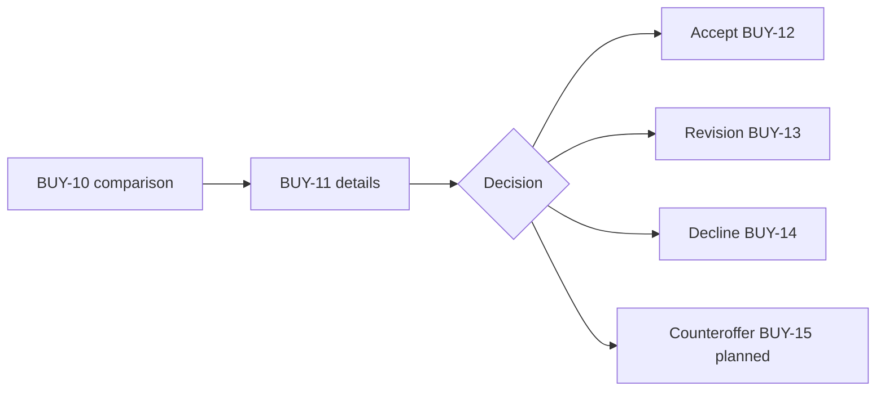

## J-15 · Accepting or rejecting quotations

**Roles:** Buyer OWNER, PROCUREMENT · **Status:** Implemented

**Starting point:** Comparison (BUY-10).

**Steps:**

1. Accept: confirms the exact version and an optional PO reference (BUY-12).
2. System awards RFQ, declines other quotes, creates checkout (source QUOTE) and order with 72-hour payment window.
3. Buyer chooses a delivery address in the quoted emirate when starting payment (BUY-18).
4. Decline: confirms (BUY-14); seller notified.

| Aspect | Detail |
|---|---|
| Required screens | BUY-12, BUY-14, BUY-18 |
| User decisions | Accept vs decline vs revise. |
| System responses | Idempotent accept; quote.accepted / rfq.awarded_other / quote.declined notifications. |
| Success outcome | AWARDED RFQ with order awaiting payment. |
| Failure scenarios | Version superseded or expired; address emirate mismatch at payment; checkout disabled ("No order was created…"). |
| Alternative pathways | Request revision instead. |
| Permissions and restrictions | buyer.purchase. |


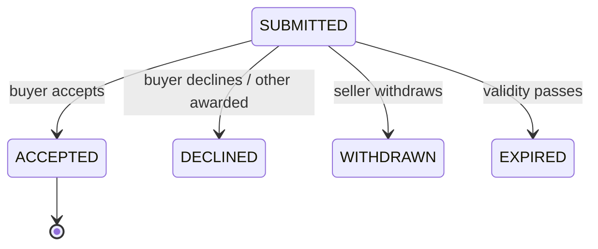

## J-16 · Creating an order

**Roles:** Buyer OWNER, PROCUREMENT · **Status:** Implemented

**Starting point:** Cart (BUY-16) or accepted quote (BUY-12).

**Steps:**

1. Catalogue: adds ready-stock SKUs from product page respecting MOQ/increment/stock; reviews cart grouped by supplier.
2. Quote: order created at acceptance.
3. Continues to checkout (J-17).

| Aspect | Detail |
|---|---|
| Required screens | PUB-07, BUY-16, BUY-12 |
| User decisions | Catalogue vs quotation route. |
| System responses | One order per supplier; server re-prices. |
| Success outcome | Order(s) in AWAITING_PAYMENT. |
| Failure scenarios | Line issues block checkout; self-trade blocked. |
| Alternative pathways | Request quotation for QUOTE_ONLY or made-to-order items. |
| Permissions and restrictions | buyer.purchase. |


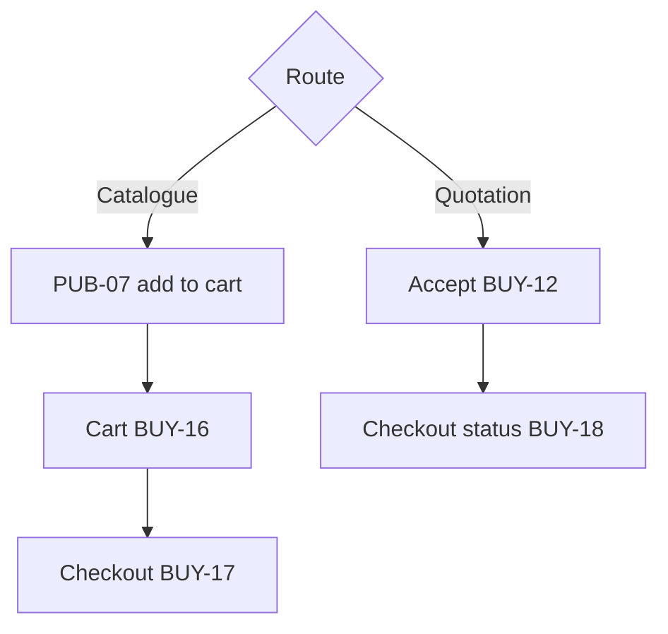

## J-17 · Completing checkout

**Roles:** Buyer OWNER, PROCUREMENT · **Status:** Implemented

**Starting point:** Cart › Continue to checkout (BUY-17).

**Steps:**

1. Selects UAE address (or adds one).
2. Reviews per-supplier delivery, tax and totals; enters PO reference; accepts terms.
3. Places order and pays → checkout PENDING_PAYMENT, 15-minute stock reservation.

| Aspect | Detail |
|---|---|
| Required screens | BUY-17, BUY-20, BUY-21, BUY-18, BUY-19 |
| User decisions | Address; accept terms. |
| System responses | Preview hash; 409 if prices or stock changed; reservation. |
| Success outcome | Checkout created; redirected to payment. |
| Failure scenarios | Emirate not served; no delivery terms; prices changed; stock gone. |
| Alternative pathways | Cancel checkout (BUY-19). |
| Permissions and restrictions | buyer.purchase. |


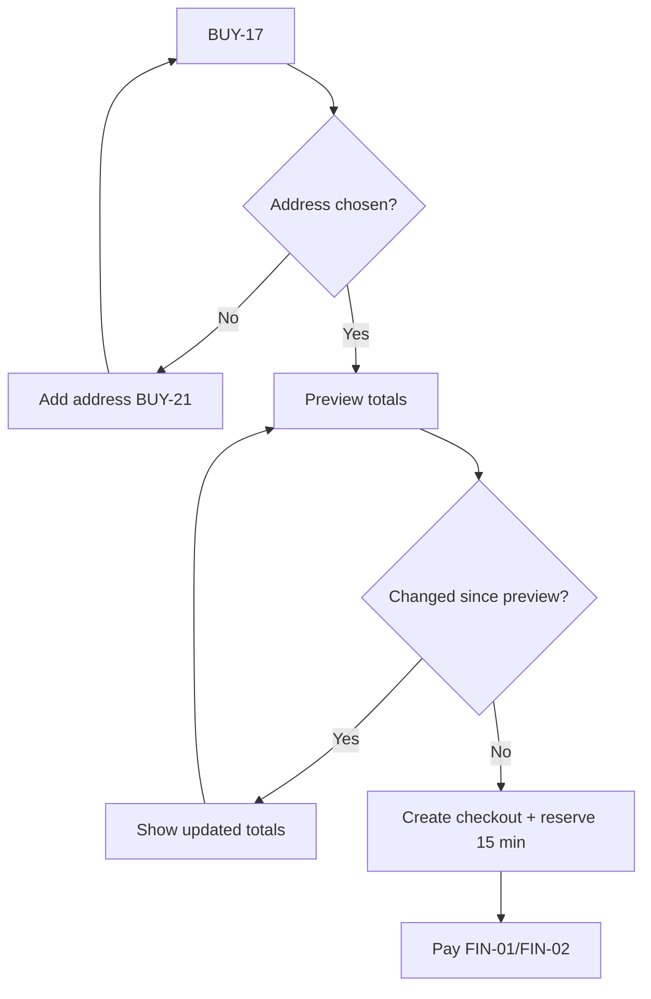

## J-18 · Making payments

**Roles:** Buyer OWNER, PROCUREMENT · **Status:** Partial (sandbox only)

**Starting point:** Checkout status (BUY-18) › Pay now.

**Steps:**

1. Redirected to the sandbox payment page (FIN-01), labelled "no real money".
2. Simulates success or failure.
3. Returns to BUY-18, which polls until the webhook confirms: PAID → orders CONFIRMED; or FAILED with code and retry (≤5 attempts).
4. Deadline: 15 minutes (cart) / 72 hours (quote); expiry cancels orders and releases stock.

| Aspect | Detail |
|---|---|
| Required screens | BUY-18, FIN-01, FIN-02, FIN-03 |
| User decisions | Retry or cancel. |
| System responses | Payment confirmed only from verified provider webhook; late capture → RECONCILIATION_REQUIRED. |
| Success outcome | Orders CONFIRMED; buyer and seller notified (order.paid / order.received). |
| Failure scenarios | Failed attempt; expired window; late payment under finance review. |
| Alternative pathways | Live provider (FIN-02) and bank transfer (FIN-03) are blocked. |
| Permissions and restrictions | Owner/procurement of the checkout workspace. |


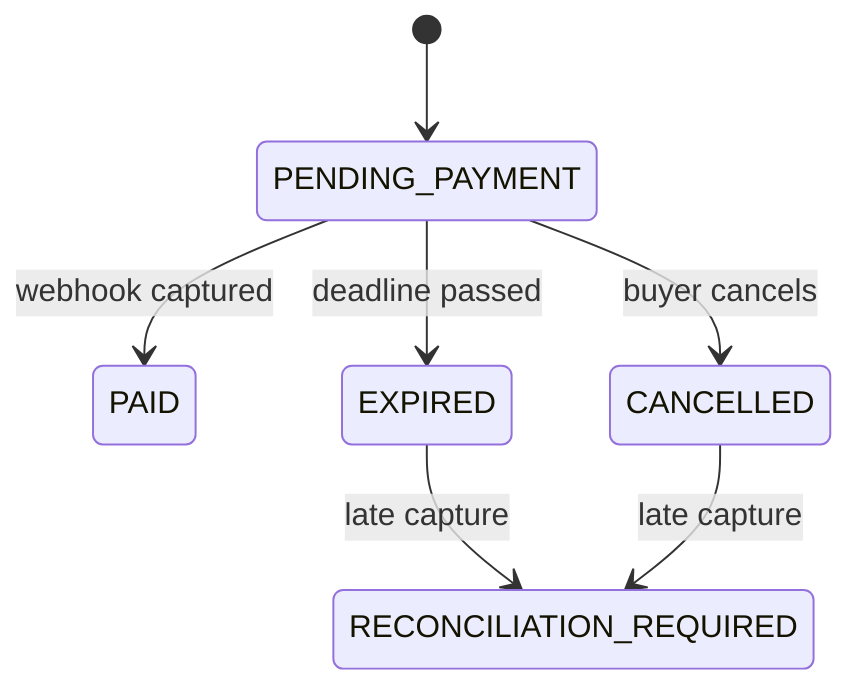

## J-19 · Managing production

**Roles:** Seller OWNER, SALES, WAREHOUSE · **Status:** Partial

**Starting point:** Order received notification → Order detail (SEL-28).

**Steps:**

1. Starts processing (CONFIRMED → PROCESSING).
2. (Recommended) posts production milestones for made-to-order goods (SEL-38).
3. Prepares goods for dispatch.

| Aspect | Detail |
|---|---|
| Required screens | SEL-28, SEL-38, SEL-36 |
| User decisions | When to start processing. |
| System responses | Only PROCESSING state exists; no milestones. |
| Success outcome | Order in PROCESSING. |
| Failure scenarios | Cannot fulfil → no supplier cancellation yet (SEL-36 planned). |
| Alternative pathways | Message buyer about delays. |
| Permissions and restrictions | seller.inventory.ship. |


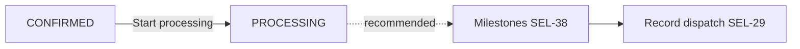

## J-20 · Tracking order progress

**Roles:** Buyer OWNER, PROCUREMENT, VIEWER · **Status:** Implemented

**Starting point:** Orders (BUY-23) or notification.

**Steps:**

1. Opens order detail (BUY-24): state, next-step text, timeline.
2. Sees fulfilment (carrier, tracking, expected date) after dispatch.

| Aspect | Detail |
|---|---|
| Required screens | BUY-23, BUY-24 |
| User decisions | — |
| System responses | Order events written on every transition. |
| Success outcome | Buyer knows status and next step. |
| Failure scenarios | — |
| Alternative pathways | Message supplier; open support ticket. |
| Permissions and restrictions | buyer.orders.read. |


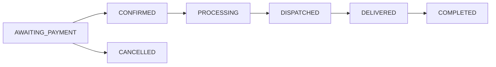

## J-21 · Managing fulfilment

**Roles:** Seller OWNER, SALES, WAREHOUSE · **Status:** Implemented

**Starting point:** Order detail (SEL-28).

**Steps:**

1. Records dispatch (SEL-29): carrier, tracking, expected date; full shipment only.
2. Reports delivery (SEL-30) with optional proof file.
3. Waits for buyer confirmation ("Waiting for the buyer to confirm receipt.").

| Aspect | Detail |
|---|---|
| Required screens | SEL-28, SEL-29, SEL-30 |
| User decisions | Upload proof or not. |
| System responses | order.dispatched / order.delivered notifications. |
| Success outcome | Order DELIVERED. |
| Failure scenarios | Upload blocked (infected); action on unpaid order rejected. |
| Alternative pathways | — |
| Permissions and restrictions | seller.inventory.ship. |


```mermaid
sequenceDiagram
participant S as Seller
participant P as Platform
participant B as Buyer
S->>P: Record dispatch
P->>B: order.dispatched
S->>P: Report delivery + proof
P->>B: order.delivered
```

## J-22 · Confirming order completion

**Roles:** Buyer OWNER, PROCUREMENT · **Status:** Implemented (auto-complete pending decision)

**Starting point:** Order detail (BUY-24).

**Steps:**

1. Clicks Confirm receipt (BUY-25) → COMPLETED.
2. Settlement becomes ELIGIBLE unless a dispute is open.
3. Rates supplier (BUY-26).

| Aspect | Detail |
|---|---|
| Required screens | BUY-24, BUY-25, BUY-26 |
| User decisions | Confirm now or open dispute. |
| System responses | order.completed notification to seller. |
| Success outcome | Order COMPLETED; review published anonymously. |
| Failure scenarios | — |
| Alternative pathways | Founder auto-complete rule (FD-02) not implemented. |
| Permissions and restrictions | buyer.orders.act. |


```mermaid
flowchart TD
A[DISPATCHED/DELIVERED] --> B{Goods OK?}
B -->|Yes| C[Confirm receipt BUY-25] --> D[COMPLETED] --> E[Review BUY-26]
B -->|No| F[Open dispute BUY-27]
```

## J-23 · Requesting cancellations

**Roles:** Buyer, seller · **Status:** Partial

**Starting point:** Checkout status (BUY-18) or order detail.

**Steps:**

1. Unpaid: buyer cancels checkout (BUY-19) → orders CANCELLED, stock released.
2. Unpaid and deadline passed: system cancels (reason "Not paid before the deadline").
3. Paid (planned): buyer request (BUY-31) or supplier cancellation (SEL-36) → refund via finance.

| Aspect | Detail |
|---|---|
| Required screens | BUY-19, BUY-31, SEL-36, SHR-04 |
| User decisions | Cancel or keep. |
| System responses | Reservation release; order.cancelled notification. |
| Success outcome | Order cancelled cleanly. |
| Failure scenarios | Paid orders today require a dispute or support ticket. |
| Alternative pathways | Support ticket (SHR-04). |
| Permissions and restrictions | buyer.purchase; planned seller.inventory.ship. |


```mermaid
flowchart TD
A{Paid?} -->|No| B[Cancel checkout BUY-19] --> C[CANCELLED + stock released]
A -->|Yes| D[Planned: request BUY-31 / SEL-36] --> E[Refund via finance]
```

## J-24 · Requesting refunds

**Roles:** Buyer (via dispute), finance · **Status:** Implemented (sandbox)

**Starting point:** Dispute proposal or finance decision.

**Steps:**

1. Buyer opens dispute (J-25); support proposes REFUND with amount.
2. FINANCE requests refund (ADM-33) up to remaining refundable amount.
3. FINANCE_APPROVER (different person) approves (ADM-34) → SUBMITTED to provider.
4. Provider confirms → SUCCEEDED; ledger updated; payment PARTIALLY_REFUNDED/REFUNDED; dispute closes.

| Aspect | Detail |
|---|---|
| Required screens | BUY-27, SHR-02, ADM-39, ADM-40, ADM-32, ADM-33, ADM-34 |
| User decisions | Approve or reject. |
| System responses | Dual control; ledger changes only on provider confirmation; commission share reversed. |
| Success outcome | Buyer refunded; notifications order.refunded. |
| Failure scenarios | Rejected; provider FAILED → reconciliation case REFUND_FAILED. |
| Alternative pathways | Finance-initiated refund without dispute. |
| Permissions and restrictions | admin.refunds.request / approve. |


```mermaid
stateDiagram-v2
[*] --> REQUESTED
REQUESTED --> APPROVED: second finance user
REQUESTED --> REJECTED
APPROVED --> SUBMITTED: sent to provider
SUBMITTED --> SUCCEEDED
SUBMITTED --> FAILED
```

## J-25 · Opening disputes

**Roles:** Buyer OWNER, PROCUREMENT; seller · **Status:** Implemented

**Starting point:** Order detail (BUY-24 / SEL-28).

**Steps:**

1. Selects problem type and describes what happened (BUY-27 / SEL-31).
2. Dispute OPEN; settlement HELD; other party notified.
3. Adds messages and evidence (SHR-02).

| Aspect | Detail |
|---|---|
| Required screens | BUY-27, SEL-31, SHR-02 |
| User decisions | Type of problem. |
| System responses | Window: 14 days after receipt (P5-3); never after payout. |
| Success outcome | Dispute opened; payout held. |
| Failure scenarios | Window passed; already paid out; one open dispute per order. |
| Alternative pathways | Support ticket instead. |
| Permissions and restrictions | buyer.orders.act / seller.inventory.ship. |


```mermaid
flowchart LR
A[Order] --> B[Open dispute] --> C[OPEN + payout HELD] --> D[Messages & evidence SHR-02]
```

## J-26 · Resolving disputes

**Roles:** Platform SUPPORT, FINANCE · **Status:** Implemented (sandbox refunds)

**Starting point:** Admin disputes queue (ADM-38).

**Steps:**

1. Support assigns to self (OPEN → UNDER_REVIEW); reviews evidence; may request evidence (AWAITING_EVIDENCE); a party reply returns it to UNDER_REVIEW.
2. Proposes resolution: NO_ACTION or REFUND amount (RESOLUTION_PROPOSED).
3. REFUND: finance requests the refund against the dispute (RESOLVING); the dispute closes when the provider confirms; a rejected refund returns it to RESOLUTION_PROPOSED. NO_ACTION: support closes it.

| Aspect | Detail |
|---|---|
| Required screens | ADM-38, ADM-39, ADM-40, ADM-32 |
| User decisions | No action vs refund; amount. |
| System responses | Both parties notified (dispute.updated); settlement released or adjusted. |
| Success outcome | Dispute CLOSED. |
| Failure scenarios | Refund fails → reconciliation. |
| Alternative pathways | Propose NO_ACTION, then close. |
| Permissions and restrictions | admin.disputes.manage; refunds dual control. |


```mermaid
stateDiagram-v2
[*] --> OPEN
OPEN --> UNDER_REVIEW: assigned
UNDER_REVIEW --> AWAITING_EVIDENCE: request evidence
RESOLUTION_PROPOSED --> AWAITING_EVIDENCE: request evidence
AWAITING_EVIDENCE --> UNDER_REVIEW: party replies
UNDER_REVIEW --> RESOLUTION_PROPOSED: propose
AWAITING_EVIDENCE --> RESOLUTION_PROPOSED: propose
RESOLUTION_PROPOSED --> RESOLVING: finance requests refund
RESOLVING --> RESOLUTION_PROPOSED: refund rejected
RESOLVING --> CLOSED: provider confirms refund
RESOLUTION_PROPOSED --> CLOSED: close (no action proposal)
```

## J-27 · Receiving payouts

**Roles:** Seller OWNER, FINANCE; platform finance · **Status:** Implemented (sandbox, manual)

**Starting point:** Seller finance (SEL-32) / admin payouts (ADM-35).

**Steps:**

1. Completed undisputed orders become ELIGIBLE.
2. FINANCE requests a payout for all eligible orders of a seller (ADM-36).
3. FINANCE_APPROVER approves (ADM-37) → PENDING at provider.
4. Provider confirms PAID (or FAILED) → seller notified; settlements PAID_OUT.

| Aspect | Detail |
|---|---|
| Required screens | SEL-32, SEL-33, ADM-35, ADM-36, ADM-37 |
| User decisions | Approve or reject. |
| System responses | Founder wants weekly runs after the window (FD-04); payout onboarding blocked (SEL-33). |
| Success outcome | Seller paid (sandbox). |
| Failure scenarios | Provider failure → PAYOUT_FAILED case. |
| Alternative pathways | — |
| Permissions and restrictions | admin.payouts.request / approve; seller.finance to view. |


```mermaid
stateDiagram-v2
[*] --> REQUESTED
REQUESTED --> APPROVED
REQUESTED --> REJECTED
APPROVED --> PENDING: sent to provider
PENDING --> PAID
PENDING --> FAILED
```

## J-28 · Contacting customer support

**Roles:** Any workspace member (not VIEWER for writing) · **Status:** Implemented

**Starting point:** Sub-nav › Support (SHR-03).

**Steps:**

1. Opens ticket (SHR-04): topic, subject, message, optional linked order/RFQ.
2. Support takes ticket (ASSIGNED), replies; may set WAITING_CUSTOMER.
3. Customer replies; support resolves (RESOLVED); customer can reopen or close (CLOSED).

| Aspect | Detail |
|---|---|
| Required screens | SHR-03, SHR-04, SHR-05, SHR-06, ADM-42, ADM-43 |
| User decisions | Topic; link record. |
| System responses | support.replied / support.resolved always emailed. |
| Success outcome | Issue resolved. |
| Failure scenarios | Open-ticket limit reached; VIEWER cannot write. |
| Alternative pathways | Disputes for order problems. |
| Permissions and restrictions | Workspace membership. |


```mermaid
stateDiagram-v2
[*] --> OPEN
OPEN --> ASSIGNED: agent takes
ASSIGNED --> WAITING_CUSTOMER
WAITING_CUSTOMER --> ASSIGNED: customer replies
ASSIGNED --> RESOLVED
RESOLVED --> ASSIGNED: reopen
RESOLVED --> CLOSED
OPEN --> CLOSED: customer closes
```

## J-29 · Managing account settings

**Roles:** Any company user · **Status:** Implemented

**Starting point:** Header › Settings (ACC-13).

**Steps:**

1. Edits name and language; changes password (re-auth).
2. Sets email notification preferences (RFQs, quotes/orders, messages, marketing opt-in).
3. Signs out other sessions.
4. Owners manage team (ACC-09) and company (ACC-03).

| Aspect | Detail |
|---|---|
| Required screens | ACC-13, ACC-09, ACC-03, ACC-16 |
| User decisions | — |
| System responses | password_changed email; session rotation. |
| Success outcome | Settings saved. |
| Failure scenarios | Wrong current password; weak new password. |
| Alternative pathways | Account closure (ACC-16, planned). |
| Permissions and restrictions | Own account; owners for team/company. |


```mermaid
flowchart LR
A[Settings ACC-13] --> B[Profile & language] & C[Password] & D[Notifications] & E[Sessions]
```

## J-30 · Administrative approval and verification

**Roles:** Platform COMPLIANCE · **Status:** Implemented

**Starting point:** Admin sign-in (AUTH-10, MFA AUTH-13) → Verification queue (ADM-02).

**Steps:**

1. Opens case (ADM-03); starts review (assign).
2. Downloads clean documents (audited); checks licence details.
3. Decides (ADM-04): approve / needs info (reason) / reject (reason).
4. Company notified by email + in-app; workspaces activate on approval.

| Aspect | Detail |
|---|---|
| Required screens | AUTH-10, AUTH-13, ADM-02, ADM-03, ADM-04, ADM-06, ADM-07 |
| User decisions | Approve, request info, reject. |
| System responses | Audit log; verification_decided email. |
| Success outcome | Decision recorded. |
| Failure scenarios | Infected documents unavailable; session expired (re-auth). |
| Alternative pathways | Suspend later (ADM-07). |
| Permissions and restrictions | admin.verification.review; MFA mandatory. |


```mermaid
flowchart TD
A[Admin sign-in + TOTP] --> B[Queue ADM-02] --> C[Case ADM-03] --> D[Start review] --> E{Decision ADM-04}
E --> F[APPROVED] & G[NEEDS_INFO] & H[REJECTED]
```

## J-31 · Financial reconciliation

**Roles:** Platform FINANCE, FINANCE_APPROVER · **Status:** Partial (cases visible; no resolution)

**Starting point:** Finance overview (ADM-30).

**Steps:**

1. System opens cases: late capture, amount/currency mismatch, unknown reference, invalid signature, refund failed, payout failed.
2. Finance reviews cases and ledger balances (provider clearing, payable to suppliers, platform commission, unallocated receipts).
3. (Planned) resolves a case with dual control (ADM-31): refund, allocate, write-off.

| Aspect | Detail |
|---|---|
| Required screens | ADM-30, ADM-31, ADM-44 |
| User decisions | Resolution type. |
| System responses | Webhooks verified and stored once; quarantined if invalid. |
| Success outcome | Ledger and provider balances agree. |
| Failure scenarios | No resolution tooling today (G-12). |
| Alternative pathways | Export reports (ADM-44). |
| Permissions and restrictions | admin.finance.read; resolution capability to be defined. |


```mermaid
flowchart TD
A[Webhook / provider event] --> B{Matches open checkout?}
B -->|Yes| C[Normal capture]
B -->|No| D[Reconciliation case OPEN] --> E[Finance review ADM-30] --> F[Planned resolution ADM-31] --> G[RESOLVED]
```
