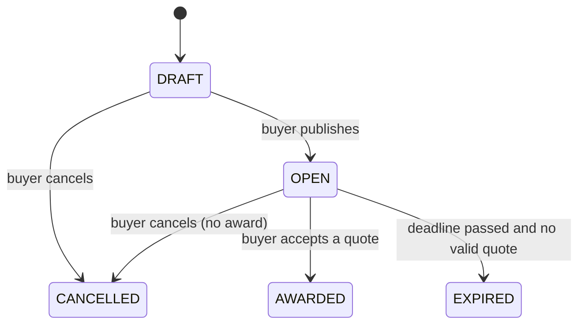
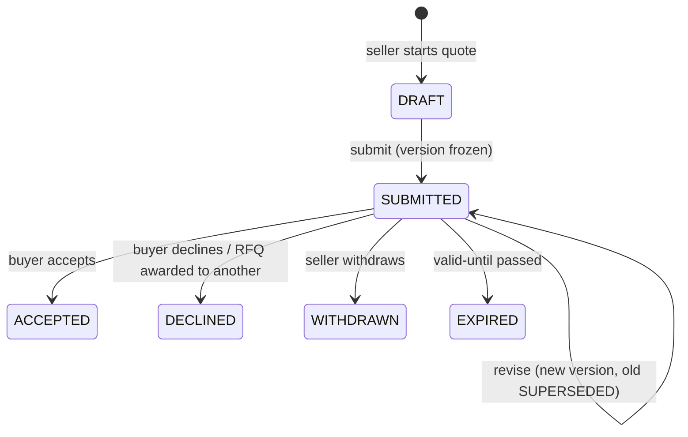

# 11. RFQ and quotation system

Implemented in Phase 3 (PR #5). Contracts: `packages/contracts/src/rfq.ts`; services `apps/api/src/rfq/rfq.service.ts`, `quote.service.ts`; worker expiry `apps/worker/src/jobs.ts` (`runRfqExpiry`, every minute). Provisional rules P3-1…P3-7 in `docs/00-decisions.md`. Founder decisions of 2026-11-28 add: default quote validity 7 days (supplier-configurable), public or private RFQs, counteroffers and revisions.

## 11.1 Screens

| Step | Buyer | Supplier | Admin |
|---|---|---|---|
| Entry | BUY-04 entry chooser, BUY-02 list | SEL-20 inbox | ADM-25 list |
| Create | BUY-03 new request, BUY-09 invite picker | — | — |
| Draft | BUY-05 detail (draft), BUY-06 edit, BUY-08 cancel | — | — |
| Publish | BUY-07 publish dialog | notification rfq.invited / rfq.matched | — |
| Quote | — | SEL-21 detail, SEL-22 quote form, SEL-23 submit, SEL-25 ask buyer | — |
| Compare | BUY-10 comparison, BUY-11 details/versions | — | ADM-26 metadata + quote states |
| Negotiate | BUY-13 request revision, BUY-15 counteroffer (planned) | SEL-22 revise, SEL-24 withdraw | — |
| Decide | BUY-12 accept, BUY-14 decline | outcome panels on SEL-21 | ADM-27 hide/unhide |
| Convert | BUY-18 checkout status (pay within 72 hours), BUY-24 order | SEL-28 order | ADM-29 |

## 11.2 RFQ creation form (BUY-03)

| Field | Type | Required | Rules / options | Stored as |
|---|---|---|---|---|
| Title | text | Yes | 1–160 characters | `rfqs.title` |
| Category | select | Yes | Active, non-BLOCKED category | `rfqs.category_id` |
| Quantity | integer | Yes | 1–10,000,000 | `rfqs.quantity` |
| Unit | select | Yes | PIECE, CARTON, BOX, PACK, SET, PAIR, ROLL, DOZEN | `rfqs.unit` |
| Specifications | textarea | Yes | 1–5000; hint "Describe the goods, standards, packaging and delivery terms you need." | `rfqs.specs` |
| Delivery emirate | select | Yes | Abu Dhabi, Dubai, Sharjah, Ajman, Umm Al Quwain, Ras Al Khaimah, Fujairah | `rfqs.delivery_emirate` |
| Needed by | date | No | Calendar date | `rfqs.target_date` |
| Quote deadline (Dubai time) | date-time | Yes | 60 minutes to 90 days from now, entered in Dubai time, stored UTC | `rfqs.deadline` |
| Who can quote | radio | Yes | **Matching suppliers** (POOL: verified suppliers with public listings in this category, plus invitees) or **Invited suppliers only** (INVITE) | `rfqs.visibility` |
| Budget (AED) | money | No | Optional; "Shared with suppliers who can see this request." | `rfqs.budget_fils` |
| Invited suppliers | multi-select | When INVITE | ≤20; public, trading-eligible suppliers; never own company | `rfq_invitations` |
| Attachments | file | No | ≤5, PDF/PNG/JPEG ≤10 MB, malware-scanned, private | `rfq_files` → `files` |

**Customisation requirements** are written in Specifications today; there are no structured customisation fields (recommended: checkboxes for custom manufacturing, private label, packaging, sample needed — FD-13). **Required product information**: when started from a product page, the RFQ is prefilled with the product and supplier (supplier added as invitee).

Limits: 50 open RFQs per workspace (`rfq.open_limit`). Draft saved first; attachments added to the draft; publish requires clean files (`rfq.files_not_clean`).

## 11.3 RFQ submission (publish)
Dialog copy: "Publish this request?" + POOL or INVITE body. On publish: state OPEN, invitees get `rfq.invited`, eligible pool sellers get `rfq.matched` (in-app + email if "RFQs" email preference on). Hidden RFQs cannot be published (`rfq.hidden`).

## 11.4 Supplier RFQ inbox (SEL-20)
Scopes: All, Invited, Matching, Quoted. Search by title or reference. Row: reference, title, buyer company, category, quantity + unit, deadline (Dubai), Invited badge, "Your quote" state or "Not quoted". A seller never sees another seller's quote. Hidden RFQs disappear for sellers.

## 11.5 Quotation creation form (SEL-22)

| Field | Type | Required | Rules |
|---|---|---|---|
| Quantity | integer | Yes | 1–10,000,000 |
| Unit price (AED, before tax) | money | Yes | ≥0, integer fils |
| Shipping (AED, before tax) | money | No | ≥0 |
| Tax treatment | select | Yes | STANDARD, ZERO_RATED, EXEMPT ("Tax is calculated by the platform on subtotal plus shipping.") |
| Lead time (days) | integer | Yes | 0–730 |
| Delivery date | date | No | — |
| Valid until (Dubai time) | date-time | Yes | ≤90 days ahead; **no default today**; founder default 7 days (G-22) |
| What is offered | textarea | Yes | — |
| Differences from the request | textarea | No | ≤2000 |
| Terms | textarea | No | ≤3000 |
| Attachments | file | No | PDF/PNG/JPEG ≤10 MB, scanned |

Live preview: "Subtotal plus shipping: AED {amount} before tax." The **server** computes subtotal (quantity × unit price), tax and total; the browser never totals money.

## 11.6 Pricing breakdown shown to the buyer
Per quote version: quantity, unit price, subtotal, shipping, tax (by treatment), total, lead time, delivery date, valid until. The comparison flags "Lowest total". Tax presentation will change when the disclosed-intermediary model is approved (FD-06).

## 11.7 Lead times and validity
Lead time is a number of days; delivery date optional. Validity: when `valid_until` passes, the worker marks the quote and version EXPIRED. An OPEN RFQ past its deadline **stays open for award while at least one submitted quote is still valid**; it becomes EXPIRED when no valid quote remains.

## 11.8 Quotation comparison (BUY-10)
Columns = suppliers (current version only); rows = state, version, quantity, unit price, subtotal, shipping, tax, total, lead time, delivery date, valid until, deviations (yes/no with link), revision requested. Lowest total marked with icon + text. Actions per column: Accept, Request revision, Decline, Details. Mobile: one card per supplier (recommended).

## 11.9 Acceptance and rejection
- **Accept (BUY-12):** "Accept this quote? You are accepting version {version} from {company}. Other quotes will be declined. This cannot be undone." PO reference optional (≤60). Server: idempotent (Idempotency-Key), accepts the exact `version_id`, checks it is still current and the RFQ is OPEN, then awards RFQ (AWARDED), declines other quotes (sellers get `rfq.awarded_other`), creates a checkout (source QUOTE) and one order AWAITING_PAYMENT with a **72-hour payment deadline** (D05). The delivery address is chosen when the buyer starts payment on the checkout page (BUY-18) and must be in the quoted emirate ("Choose an address in the emirate from your request."). Buyer sees "Quote accepted. Payment is due by {due} (Dubai time)." and "Pay for this order".
- **Decline (BUY-14):** "Decline the quote from {company}? This cannot be undone." Seller notified (`quote.declined`).
- If checkout is disabled: "No order was created because checkout is not available right now."

## 11.10 Quotation revisions
- Buyer **Request revision (BUY-13)**: "{company} will be asked to revise the quote. The current version stays valid." Seller notified (`quote.revision_requested`); seller panel shows "The buyer asked for a revision. Submit a revised quote."
- Seller **Revise**: creates a new version; the previous version becomes SUPERSEDED; buyer notified (`quote.revised`). Allowed while the RFQ is OPEN and before the deadline.
- **Counteroffer (planned, BUY-15)**: structured price/quantity/date proposal; mechanics pending FD-10.

## 11.11 Conversion into an order
Accepted quote → checkout (QUOTE) → payment page → on provider confirmation, order CONFIRMED (same lifecycle as catalogue orders, section 12). If not paid within 72 hours the checkout EXPIRES and the order is CANCELLED ("Not paid before the deadline").

## 11.12 Statuses

**RFQ (`RfqState`)**: DRAFT "Draft" → OPEN "Open" (publish) → AWARDED "Awarded" (quote accepted) | CANCELLED "Cancelled" (buyer, from DRAFT or OPEN without award) | EXPIRED "Expired" (deadline passed and no valid quote). Admin can hide/unhide an RFQ (flag, not a state; buyer sees "The platform has hidden this request from suppliers while it is reviewed.").

**Quote (`QuoteState`)**: DRAFT "Draft" → SUBMITTED "Submitted" → ACCEPTED "Accepted" | DECLINED "Declined" | WITHDRAWN "Withdrawn" | EXPIRED "Expired". **Quote version (`QuoteVersionState`)** adds SUPERSEDED "Superseded".

## 11.13 System states to design
Loading (skeleton), empty buyer list ("You have no requests for quotation yet."), VIEWER forbidden note, no eligible suppliers ("No eligible suppliers match."), no quotes yet ("No quotes yet."), deadline passed, hidden by platform, cancelled with reason ("Cancelled: {reason}"), awarded, expired, stale version conflict ("common.stale": someone else changed it, reload), attachment scanning/blocked, open-limit reached.
