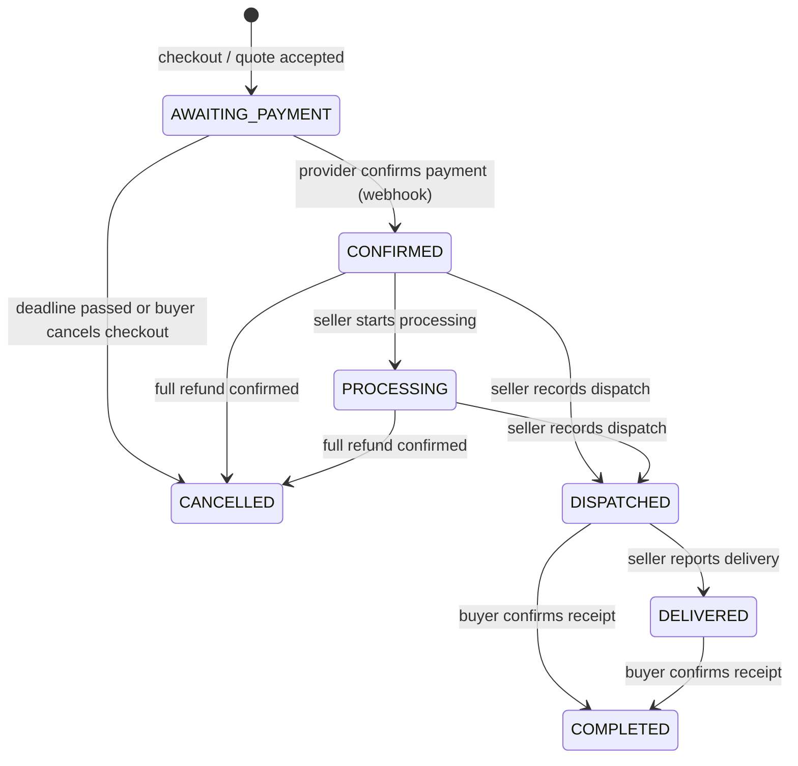

# 12. Order management and manufacturing lifecycle

Sources: `packages/db/prisma/schema.prisma` (`OrderState`, `SettlementState`, `ShipmentState`), `packages/db/src/commerce.ts` (payment, cancellation), `apps/api/src/fulfilment/fulfilment.service.ts` (process, dispatch, deliver, confirm receipt, review), `packages/db/src/settlement.ts` (refunds, payouts), provisional rules P4-1…P4-7 and P5-1…P5-7.

## 12.1 Order creation
- **Catalogue:** checkout creates one order per supplier (`source = CART`) in AWAITING_PAYMENT, with lines snapshotted (title, SKU, quantity, unit price), delivery fee, tax, total, address snapshot, commission and seller payable; stock reserved for 15 minutes.
- **Quotation:** accepting a quote creates the checkout and one order (`source = QUOTE`) in AWAITING_PAYMENT with a 72-hour deadline.
- Order number is human-readable; PO reference optional.
- "Order acceptance" by the supplier is **not a step**: a paid order is CONFIRMED automatically when the provider confirms payment. The supplier's first action is "Start processing".

## 12.2 Exact statuses and permitted transitions (`OrderState`)

| Transition | Who | API | Guard |
|---|---|---|---|
| AWAITING_PAYMENT → CONFIRMED | System (webhook) | `POST /payments/webhooks/{provider}` | Verified signature, matching amount and open checkout |
| AWAITING_PAYMENT → CANCELLED | Buyer (cart checkout) or worker | `POST …/checkouts/{id}/cancel`; expiry job | Reason `cancelled_by_buyer` or `payment_window_expired`; stock released |
| CONFIRMED → PROCESSING | Seller OWNER/SALES/WAREHOUSE | `POST …/orders/{id}/process` | State CONFIRMED |
| CONFIRMED/PROCESSING → DISPATCHED | Seller | `POST …/orders/{id}/dispatch` | Paid; full shipment |
| DISPATCHED → DELIVERED | Seller | `POST …/orders/{id}/deliver` | Optional proof (scanned) |
| DISPATCHED/DELIVERED → COMPLETED | Buyer OWNER/PROCUREMENT | `POST …/orders/{id}/confirm-receipt` | — (no auto-complete today, P5-2) |
| CONFIRMED/PROCESSING → CANCELLED | System | refund settlement | Cumulative refunds = order total (`refunded_in_full`) |

No other transitions exist: suppliers cannot cancel, buyers cannot cancel after payment, there is no partial shipment and no "returned" state.

**Parallel state – settlement (`SettlementState`)**: NOT_ELIGIBLE "Not yet eligible" → ELIGIBLE "Eligible for payout" (order completed, no open dispute) → IN_PAYOUT "In payout" → PAID_OUT "Paid out"; HELD "Held (dispute)" while a dispute is open. **Payment (`PaymentState`)** and **dispute** states are in section 16.

## 12.3 Per-status views

| Status (label) | Buyer sees | Supplier sees | Admin sees | Buyer actions | Supplier actions | Restricted | Notifications |
|---|---|---|---|---|---|---|---|
| AWAITING_PAYMENT "Awaiting payment" | Pay-by time (Dubai), "Stock is held for you until then." (cart), Pay now / Return to payment page | "The buyer has not paid yet. Do not dispatch until the order is confirmed." | Order, checkout, payment attempts | Pay, cancel (cart checkouts) | None | Seller cannot process/dispatch (`order.not_paid`) | `order.payment_due` type exists but no emitter found (recommended reminder) |
| CONFIRMED "Confirmed" | "Payment is confirmed. The supplier will prepare and dispatch the order; you confirm receipt when it arrives." | "Payment is confirmed. Prepare the goods and record dispatch." + commission and payable | Payment captured, settlement NOT_ELIGIBLE | Open dispute, message, support | Start processing, record dispatch | Buyer cannot confirm receipt yet | Buyer `order.paid`; seller `order.received` |
| PROCESSING "Processing" | Same as confirmed with "Processing started" in timeline | Record dispatch | Same | Open dispute | Record dispatch | — | none |
| DISPATCHED "Dispatched" | "The supplier has dispatched this order. Confirm receipt once the goods arrive." + carrier, tracking, expected date | "Waiting for the buyer to confirm receipt." | Shipment | Confirm receipt, open dispute | Report delivery | — | Buyer `order.dispatched` |
| DELIVERED "Delivered" | Delivery note, proof download, Confirm receipt | Waiting for receipt | Shipment + proof | Confirm receipt, open dispute | — | — | Buyer `order.delivered` |
| COMPLETED "Completed" | Receipt confirmed date, review form, dispute available for 14 days | Settlement Eligible (or Held) | Settlement | Review (once), dispute within window | — | Dispute after window or after payout | Seller `order.completed` |
| CANCELLED "Cancelled" | Cancellation reason ("Not paid before the deadline", "Cancelled by the buyer", refunded in full) | Same | Same + refunds | — | — | All actions | Buyer `order.cancelled` |

## 12.4 Manufacturing and production stages
Only PROCESSING exists between payment and dispatch. Made-to-order lead times are communicated by product lead time and quote lead time/delivery date. **Recommended** (SEL-38): optional milestones (materials secured, production started, quality check passed, ready to ship) visible to the buyer, without changing the order state machine.

## 12.5 Progress updates and timeline
Every transition writes an order event with actor side (Buyer, Supplier, System, Platform). Timeline labels: Order created, Payment confirmed, Processing started, Dispatched, Delivery reported by supplier, Receipt confirmed by buyer, Refund confirmed by provider, Paid out to supplier, Dispute opened, Order cancelled.

## 12.6 Fulfilment and delivery information
"All ordered quantities ship together in one shipment." Dispatch fields: carrier, tracking reference, expected delivery. Delivery: delivery note, proof of delivery (PDF/PNG/JPEG, scanned, audited download). Delivery method today is supplier-arranged with one flat fee per order per supplier (P4-1); founder wants courier and collection options (FD-08).

## 12.7 Completion
Buyer confirms receipt → COMPLETED; copy "This completes the order. You can still open a dispute for 14 days after confirming." Founder decision: auto-complete after the window under conditions (FD-02, FD-03) — not implemented, and the current copy "Orders are completed only when the buyer confirms receipt; nothing completes automatically." must change when it is.

## 12.8 Cancellation
Only unpaid checkouts (buyer or expiry) and automatic cancellation on full refund before dispatch. Paid-order cancellation requests (BUY-31, SEL-36) are planned.

## 12.9 Refunds
Finance-initiated, dual control, provider-confirmed (section 13). Partial refunds keep the order state and show "Refunded so far"; payment becomes PARTIALLY_REFUNDED or REFUNDED.

## 12.10 Disputes
Open while the order is CONFIRMED, PROCESSING, DISPATCHED, DELIVERED or COMPLETED (within 14 days of completion) and not paid out; one open dispute per order; settlement HELD. Full flow in J-25/J-26 and section 16.
