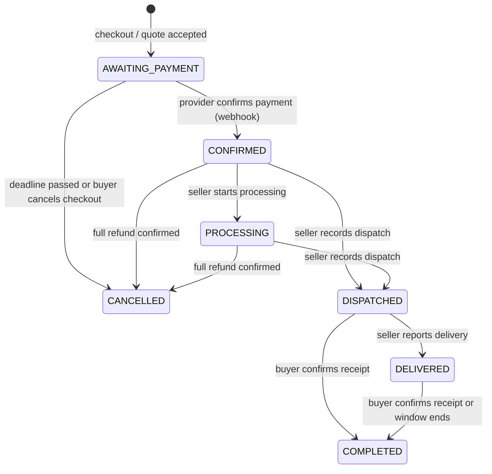

# 12. Order management and manufacturing lifecycle

Sources: `packages/db/prisma/schema.prisma` (`OrderState`, `SettlementState`, `ShipmentState`), `packages/db/src/commerce.ts` (payment, cancellation), `apps/api/src/fulfilment/fulfilment.service.ts` (process, dispatch, deliver, confirm receipt, review), `packages/db/src/settlement.ts` (refunds, payouts), provisional rules P4-1…P4-7, P5-1…P5-7 and P8-1…P8-14 (PRs #13–#17).

## 12.1 Order creation
- **Catalogue:** checkout creates one order per supplier (`source = CART`) in AWAITING_PAYMENT, with lines snapshotted (title, SKU, quantity, unit price), delivery fee, tax, total, address snapshot, commission and seller payable; stock reserved for 15 minutes.
- **Quotation:** accepting a quote creates the checkout and one order (`source = QUOTE`) in AWAITING_PAYMENT with a 72-hour deadline.
- Order number is human-readable; PO reference optional.
- "Order acceptance" by the supplier is **not a step**: a paid order is CONFIRMED automatically when the provider confirms payment. The supplier's first action is "Start processing".

## 12.2 Exact statuses and permitted transitions (`OrderState`)

| Transition | Who | API | Guard |
|---|---|---|---|
| AWAITING_PAYMENT → CONFIRMED | System (webhook) | `POST /payments/webhooks/{provider}` | Verified signature, matching amount and open checkout |
| AWAITING_PAYMENT → CANCELLED | Buyer (cart checkout) or worker | `POST …/checkouts/{id}/cancel`; expiry job | Reason `cancelled_by_buyer` or `payment_window_expired`; stock released |
| CONFIRMED → PROCESSING | Seller OWNER/SALES/WAREHOUSE | `POST …/orders/{id}/process` | State CONFIRMED |
| CONFIRMED/PROCESSING → DISPATCHED | Seller | `POST …/orders/{id}/dispatch` | Paid; full shipment |
| DISPATCHED → DELIVERED | Seller | `POST …/orders/{id}/deliver` | Proof (scanned); a clean proof verifies delivery and starts the window (P8-1) |
| DISPATCHED/DELIVERED → COMPLETED | Buyer OWNER/PROCUREMENT | `POST …/orders/{id}/confirm-receipt` | Records receipt; verifies delivery if proof had not; the window is not shortened (FD-02) |
| DELIVERED → COMPLETED | System (auto-completion sweep, P8-3) | background task | Window ended; no open dispute, hold, reconciliation case or pending refund |
| CONFIRMED/PROCESSING → cancellation pending | Seller OWNER/SALES | `POST …/orders/{id}/cancel` (PR #17) | Not dispatched; creates a full refund for finance approval |
| CONFIRMED/PROCESSING → cancellation requested | Buyer OWNER/PROCUREMENT (planned, founder Q12) | `POST …/orders/{id}/cancellation-requests` | Not dispatched; supplier decides (SEL-41), finance approves any refund |
| CONFIRMED/PROCESSING → CANCELLED | System | refund settlement | Cumulative refunds = order total (`refunded_in_full`) |

There is no partial shipment and no "returned" state; returns of damaged, wrong, short or missing goods go through disputes (FD-09).

**Parallel state – settlement (`SettlementState`)**: NOT_ELIGIBLE "Not yet eligible" → ELIGIBLE "Eligible for payout" (verified delivery, dispute window ended, no dispute, hold, reconciliation case or pending refund; P8-2) → IN_PAYOUT "In payout" → PAID_OUT "Paid out"; HELD "Held" while a dispute, settlement hold (Compliance, Fraud, Reconciliation, Payment investigation; P8-4), reconciliation case or pending refund exists. **Payment (`PaymentState`)** and **dispute** states are in section 16.

## 12.3 Per-status views

| Status (label) | Buyer sees | Supplier sees | Admin sees | Buyer actions | Supplier actions | Restricted | Notifications |
|---|---|---|---|---|---|---|---|
| AWAITING_PAYMENT "Awaiting payment" | Pay-by time (Dubai), "Stock is held for you until then." (cart), Pay now / Return to payment page | "The buyer has not paid yet. Do not dispatch until the order is confirmed." | Order, checkout, payment attempts | Pay, cancel (cart checkouts) | None | Seller cannot process/dispatch (`order.not_paid`) | `order.payment_due` type exists but no emitter found (recommended reminder) |
| CONFIRMED "Confirmed" | "Payment is confirmed. The supplier will prepare and dispatch the order; you confirm receipt when it arrives." | "Payment is confirmed. Prepare the goods and record dispatch." + commission and payable | Payment captured, settlement NOT_ELIGIBLE | Open dispute, message, support | Start processing, record dispatch | Buyer cannot confirm receipt yet | Buyer `order.paid`; seller `order.received` |
| PROCESSING "Processing" | Same as confirmed with "Processing started" in timeline | Record dispatch | Same | Open dispute | Record dispatch | — | none |
| DISPATCHED "Dispatched" | "The supplier has dispatched this order. Confirm receipt once the goods arrive." + carrier, tracking, expected date | "Waiting for the buyer to confirm receipt." | Shipment | Confirm receipt, open dispute | Report delivery | — | Buyer `order.dispatched` |
| DELIVERED "Delivered" | Delivery note, proof download, Confirm receipt | Waiting for receipt | Shipment + proof | Confirm receipt, open dispute | — | — | Buyer `order.delivered` |
| COMPLETED "Completed" | Delivery verified date and source, "You can open a dispute until {date}", review form | Settlement Not yet eligible until the window ends, then Eligible (or Held) | Settlement, holds | Review (once), dispute within the 14-day window from verified delivery | — | Dispute after window or after payout | Seller `order.completed` |
| CANCELLED "Cancelled" | Cancellation reason ("Not paid before the deadline", "Cancelled by the buyer", refunded in full) | Same | Same + refunds | — | — | All actions | Buyer `order.cancelled` |

## 12.4 Manufacturing and production stages
Only PROCESSING exists between payment and dispatch. Made-to-order lead times are communicated by product lead time and quote lead time/delivery date. **Recommended** (SEL-38): optional milestones (materials secured, production started, quality check passed, ready to ship) visible to the buyer, without changing the order state machine.

## 12.5 Progress updates and timeline
Every transition writes an order event with actor side (Buyer, Supplier, System, Platform). Timeline labels: Order created, Payment confirmed, Processing started, Dispatched, Delivery reported by supplier, Receipt confirmed by buyer, Refund confirmed by provider, Paid out to supplier, Dispute opened, Order cancelled.

## 12.6 Fulfilment, delivery and collection
"All ordered quantities ship together in one shipment." Dispatch fields: carrier, tracking reference, expected delivery. Delivery: delivery note, proof of delivery (PDF/PNG/JPEG, scanned, audited download). Today the supplier charges one flat fee per order (P4-1). FD-08 (answer A) and founder section 6, being built as C-10:

| Element | Specification |
|---|---|
| Delivery fees | A fee per emirate for Abu Dhabi, Dubai, Sharjah, Ajman, Ras Al Khaimah, Fujairah and Umm Al Quwain; each emirate can be switched off (SEL-04) |
| Buyer collection | Free; supplier gives a collection address and instructions shown only to the buyer of a paid collection order (BUY-36) |
| Quotation charges | Large, heavy or customised orders use the delivery charge agreed in the quotation |
| Checkout | Per supplier the buyer chooses delivery or collection (BUY-35); unavailable options are shown disabled with the reason |
| Snapshot | Method, fee and terms are stored on the order and never change afterwards |
| Evidence | Proof of dispatch and tracking for courier deliveries; proof of delivery; collection orders record "Collected by buyer" |
| Review | Contested or suspicious delivery proof is reviewed by the platform (ADM-59, FD-03) |

## 12.7 Verified delivery and completion (PR #13, FD-02, FD-03)
Delivery is verified by the supplier's clean proof of delivery or the buyer's confirmation of receipt, whichever comes first; the source is shown ("proof of delivery" or "buyer confirmed receipt"). The 14-day dispute window starts at verified delivery. Confirming receipt records delivery only and never shortens the window; copy: "Confirm that the goods arrived. You can still open a dispute until {date}." When the window ends with no dispute, hold, reconciliation case or pending refund, the order completes automatically ("Completed automatically after the dispute window") and the settlement becomes eligible for the next weekly payout.

## 12.8 Cancellation (FD-09, founder Q12)
| Case | Who | Screen | Outcome |
|---|---|---|---|
| Unpaid checkout | Buyer, or expiry | BUY-19 | Orders cancelled, stock released |
| Paid, not dispatched, supplier cancels | Supplier | SEL-36 (implemented, PR #17) | Full refund requested; finance approver decides; order shows "Cancellation requested on {date}: {reason}…" |
| Paid, not dispatched, buyer asks, ready stock | Buyer → supplier → finance | BUY-31, SEL-41 (planned) | Supplier accepts → full refund for finance approval; or declines with a reason |
| Paid, not dispatched, buyer asks, made to order | Buyer → supplier → finance | BUY-31, SEL-41 (planned) | Reviewed against production status, quote terms, disclosed policy and committed costs; accept, accept with a deduction for committed costs, or decline; never an automatic refund |
| After dispatch | Buyer | BUY-27 | Dispute after delivery; no cancellation |

Every step is audited and every refund follows dual control (FD-01). Supplier return policies (EN/AR) are shown on the storefront and at checkout (PR #17).

## 12.9 Refunds
Finance-initiated, dual control, provider-confirmed (section 13). Since PR #13 a refund can be split into merchandise, delivery and VAT; commission is reversed on merchandise only. Partial refunds keep the order state and show "Refunded so far"; payment becomes PARTIALLY_REFUNDED or REFUNDED.

## 12.10 Disputes
Open while the order is CONFIRMED, PROCESSING, DISPATCHED, DELIVERED or COMPLETED (within 14 days of verified delivery) and not paid out; one open dispute per order; settlement HELD. Full flow in J-25/J-26 and section 16.
